# Does Cough Audio Add Value Under Country Shift?

**Tuberculosis triage from smartphone cough recordings: pipeline, baselines and feature analysis on the Zambia CIDRZ dataset**

Martin Koome · Odunayo Akinlade · Yusuf Olaniyi · Michael Quaicoe
Carnegie Mellon University · Introduction to Deep Learning (Fall 2026) · Course project

Smartphone cough recordings have been proposed as a cheap, specimen-free way to screen for
tuberculosis (TB), but models that work in one study often fail in another. Our project asks
whether cough audio adds anything to the questions a health worker already asks when an
entire country is held out from model development. While access to the multi-country
CODA TB DREAM data is being finalised, we built and validated the full pipeline on the
**Zambia CIDRZ** dataset, where every participant was recorded by four devices at once.

**Results so far.** On the same 325 participants, a fine-tuned **VGGish** cough model and a
questionnaire-only logistic regression perform equally (AUROC **0.740 ± 0.086** and
**0.749 ± 0.094**; paired DeLong Δ = +0.020, 95 % CI −0.069 to 0.109). Both reproduce the
published baselines within one standard deviation. A feature analysis shows why transfer is
hard: a linear probe recognises the **recording phone almost perfectly (AUROC 0.994)** but
**TB status only weakly (0.665)**. Recording conditions, which differ between countries,
dominate what the cough features encode.

<p align="left">
  
  
  
  
  
</p>

## Contents

1. [Motivation and research question](#1-motivation-and-research-question)
2. [Background and related work](#2-background-and-related-work)
3. [Data](#3-data)
4. [Exploratory data analysis](#4-exploratory-data-analysis)
5. [Data preparation pipeline](#5-data-preparation-pipeline)
6. [Models](#6-models)
7. [Evaluation protocol](#7-evaluation-protocol)
8. [Results](#8-results)
9. [Why cough features transfer poorly: embedding analysis](#9-why-cough-features-transfer-poorly-embedding-analysis)
10. [Discussion, limitations and risks](#10-discussion-limitations-and-risks)
11. [Next steps](#11-next-steps)
12. [Repository structure](#12-repository-structure)
13. [Reproducing the results](#13-reproducing-the-results)
14. [References](#14-references)
15. [Acknowledgements](#15-acknowledgements)

---

## 1. Motivation and research question

TB is the leading infectious cause of death worldwide, and confirming it usually requires
sputum and a laboratory. The WHO has therefore prioritised a **non-sputum triage test** that
decides who should be sent for confirmation, with a target of **≥ 90 % sensitivity and
≥ 70 % specificity** [1]. Cough-based models look promising inside a single study: the CODA TB
DREAM Challenge reported AUROC 0.78 to 0.83 for cough combined with routine clinical
variables [2]. Yet external validation in Peru reported only 0.48 to 0.62 [3], and a
cross-dataset study found that learned cough representations cluster **by recording device
rather than by TB status** [4]. The clinics that would benefit most never contributed
training data, which is exactly where current models are least reliable.

**Research question.** Do self-supervised cough representations (HeAR, OPERA) improve TB
triage beyond routine clinical variables when an entire country is excluded from model
development, and does adapting the audio encoder help or hurt on that held-out country?

**Quantity of interest.** The paired gain on the same held-out patients:

$$\Delta = \mathrm{AUROC}(\text{questionnaire} + \text{cough}) - \mathrm{AUROC}(\text{questionnaire})$$

**Why Zambia first.** The Zambia CIDRZ dataset serves the country-shift study in three ways:

| Role | Why it matters |
|---|---|
| **Pipeline validation** | Published Zambia baselines exist [4], so we can check that our pipeline reproduces them. |
| **Isolating shift ingredients** | The same coughs were recorded on several devices at two clinics, which separates *device* fully and *clinic* in part, two things that a country hold-out mixes together. |
| **External test country** | Zambia is not a CODA country, so it will later serve as a fully external eighth test country. |

## 2. Background and related work

- **Zhang et al. [4]** are our closest reference. Across CODA, TBscreen and Zambia they report a
  within-Zambia AUROC of **0.755 ± 0.056** for a mel-spectrogram VGGish model and
  **0.767 ± 0.025** for logistic regression on clinical variables. They suggest, without
  testing it, that clinical variables could be a stable baseline to which audio adds
  complementary information. We test that directly.
- **Candidate encoders.** HeAR, pretrained on 313 million unlabelled body-sound clips [7], and
  OPERA, an open respiratory encoder never benchmarked on TB [8]. LoRA [9] adapts them cheaply.
- **Confounding in cough AI.** COVID-19 cough classifiers fell from AUROC 0.85 to 0.62 once
  confounders were matched [10]. We follow the participant-disjoint cross-validation of [11].
- **Multimodal TB work.** HeAR has been combined with CODA clinical data [12], but with
  clip-level predictions on a balanced subset. We instead measure the *additional* value of
  audio for the *same* held-out patients, reporting AUROC for direct comparison.

## 3. Data

| Dataset | Role | Contents |
|---|---|---|
| **CODA TB DREAM** [13] | Main study (access being finalised) | Adults with cough enrolled consecutively at clinics in seven countries; ≥ 3 solicited coughs per person on an Android phone; Xpert MTB/RIF Ultra and culture as reference standard. The accessible partition holds about 1,100 participants. |
| **Zambia CIDRZ** [7] | Development set and external test country | Questionnaire and laboratory data for **1,828 adults** from three Lusaka clinics, and **1,481 session recordings**. In each session a participant gave three single coughs and a burst of several, recorded **simultaneously** by an audio recorder and three phones. |

**Recording devices (Zambia).**

| Device | Model | Tier | Native format |
|---|---|---|---|
| Phone A | Google Pixel 3a | low | 192 kHz, stereo |
| Phone B | Samsung Galaxy A12 | mid | 192 kHz, stereo |
| Phone C | Samsung Galaxy A22 | high | 192 kHz, stereo |
| Audio recorder | — | reference | 44.1 kHz, stereo |

Median session length is about 42 s on the phones and 46 s on the recorder. Every recording
is resampled to 16 kHz mono before any processing.

**Label.** `ground_truth_tb` (Xpert and culture), available for all 1,828 participants.
Chest X-ray AI scores are also in the metadata, but they are a different test and are **never
used as model inputs**.

<p align="center">
  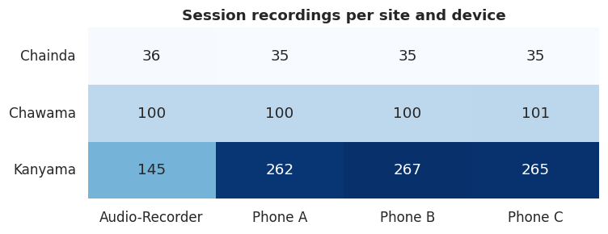
</p>

## 4. Exploratory data analysis

### 4.1 Who are the participants?

<p align="center">
  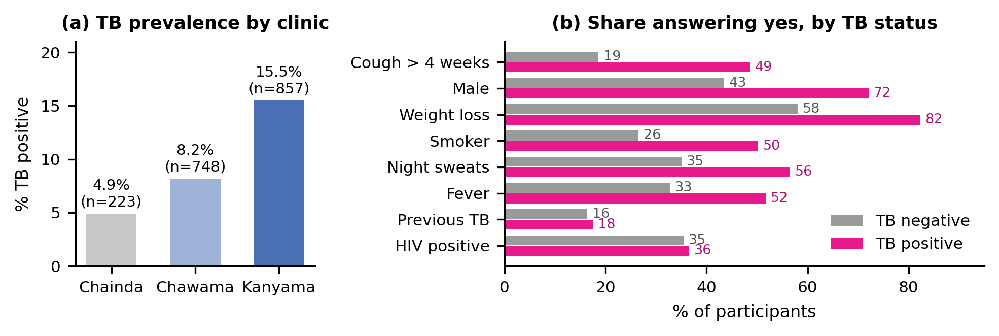
</p>

**TB prevalence differs sharply by clinic** (all 1,828 participants):

| Clinic | Participants | TB-positive | Prevalence |
|---|---:|---:|---:|
| Chainda-South | 223 | 11 | 4.9 % |
| Chawama | 748 | 61 | 8.2 % |
| Kanyama | 857 | 133 | 15.5 % |

Among participants who also have audio, prevalence is higher still: about 9 % at Chawama and
22 % at Kanyama. This imbalance between clinics matters later, because a model could appear to
"detect TB" simply by recognising Kanyama recordings (see [§9.3](#93-is-the-weak-tb-signal-real-or-is-it-the-clinic)).

**The questionnaire is a strong opponent.** Several answers separate TB-positive from
TB-negative participants clearly, while others barely differ:

| Questionnaire item | TB-negative | TB-positive |
|---|---:|---:|
| Cough > 4 weeks | 19 % | 49 % |
| Male | 43 % | 72 % |
| Weight loss | 58 % | 82 % |
| Smoker | 26 % | 50 % |
| Night sweats | 35 % | 56 % |
| Fever | 33 % | 52 % |
| Previous TB | 16 % | 18 % |
| HIV positive | 35 % | 36 % |

Cough audio must therefore carry information **beyond "has been coughing for weeks"** to be
worth adding.

<details>
<summary><b>More EDA from the notebook</b> (age, cough duration, missingness, device coverage, session length)</summary>

<p align="center">
  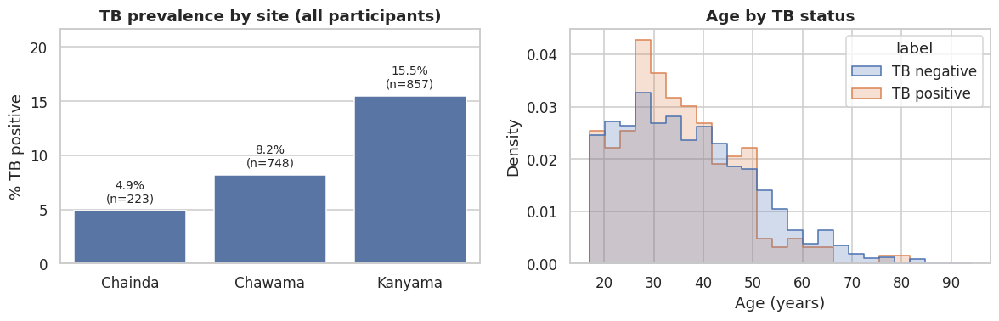
</p>
<p align="center">
  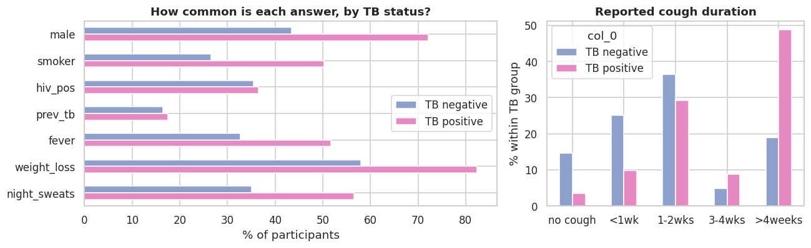
</p>
<p align="center">
  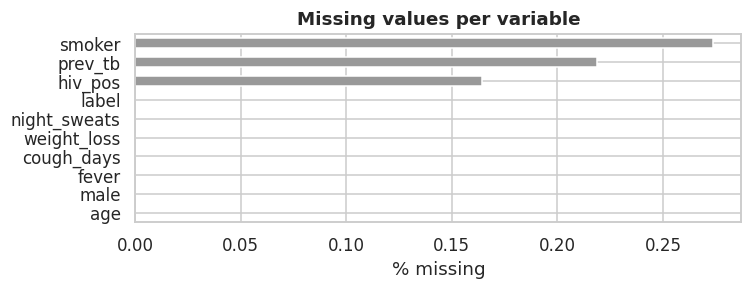
</p>

All nine clinical variables are close to complete: **1,823 participants (205 TB-positive)**
have every variable and a label, matching the count reported by Zhang et al.

<p align="center">
  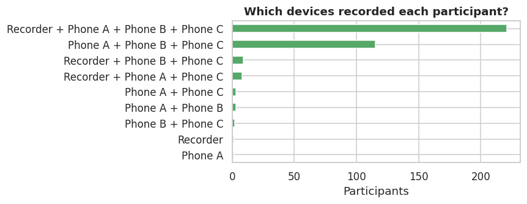
</p>
<p align="center">
  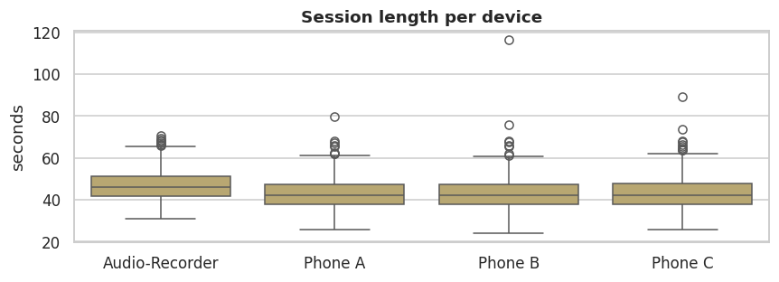
</p>

</details>

### 4.2 What does the audio look like?

<p align="center">
  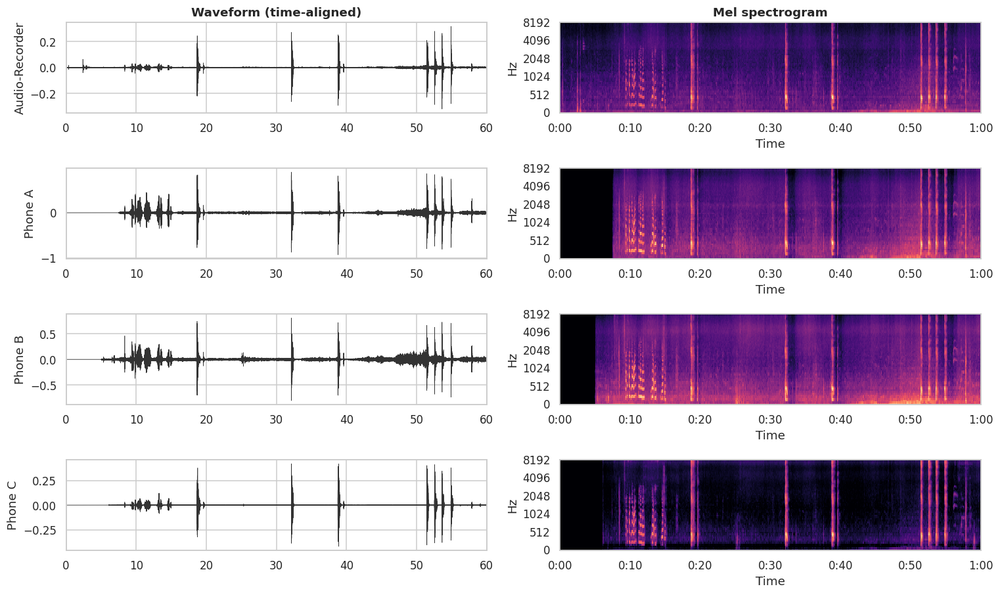
</p>

Each row is the same moment recorded by a different device. The first seconds are a staff
member reading out the participant ID; the sharp bursts after it are coughs. The coughs line
up in time on every device, but **how high they reach in frequency and how much background
they carry depends on the device**.

<p align="center">
  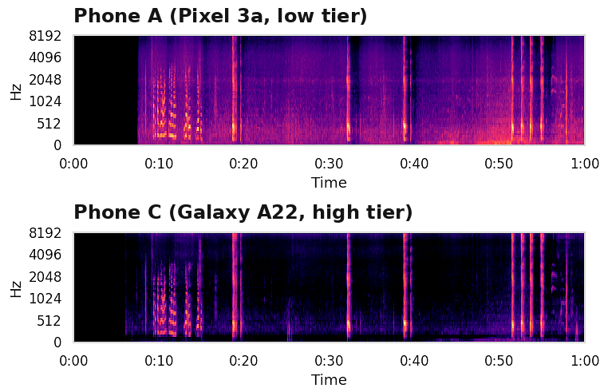
</p>

Averaging the spectrum of every cough clip per device makes these device signatures explicit.
Phone C (high tier) keeps far more energy above 5 kHz than the other devices:

<p align="center">
  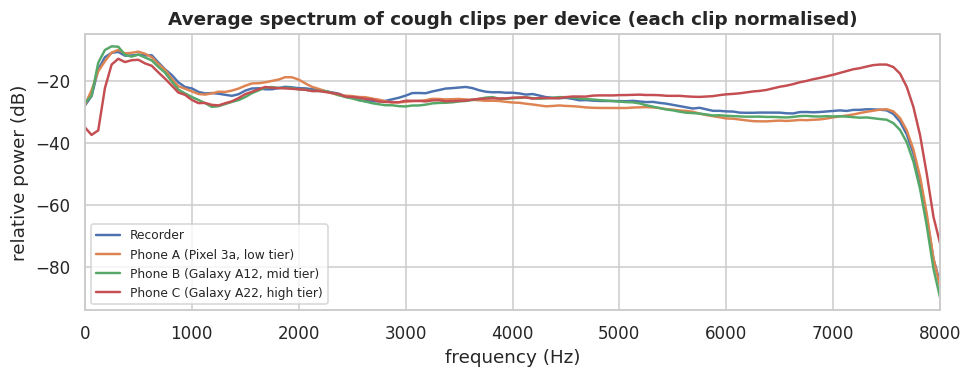
</p>

<p align="center">
  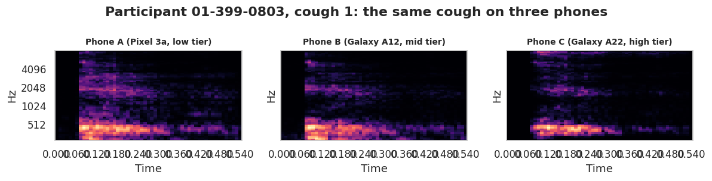
</p>

## 5. Data preparation pipeline

Nothing in the Zambia release is pre-cut into coughs or pre-linked to labels; the file path is
the only link between a sound and a person. The preparation therefore has five stages.

### 5.1 Relabelling

At the start of each session a staff member reads the participant ID aloud and then types it
as the filename, so typos happen. We applied Zhang et al.'s **62 published filename
corrections** (54 files changed), resolving chained entries (e.g. `0138 → 0838` and
`0838 → 0831`) by looking each file up *once* by its original name. Files whose ID has no
metadata row are dropped.

### 5.2 Recording audit (our addition)

The relabelling log does not catch everything: the release still contains the same participant
and device stored twice, files whose folder site disagrees with the site in their ID, and IDs
whose number appears under two site prefixes. Rather than "keep the first file found", we
**audit every recording by cross-correlation**. Four devices recording the same session hear
the same sounds at the same moments, so their waveforms line up closely; a file holding
someone else's session lines up with nothing.

1. Score 300 pairs of recordings from *different* participants to learn what "unrelated"
   looks like (median similarity 0.038, 99th percentile 0.092). The match threshold is set
   to **0.15**.
2. Score every pair of a participant's recordings (peak of the normalised cross-correlation,
   0 = unrelated, 1 = identical up to time shift and gain).
3. For each participant, keep one file per device so that the largest possible group of
   recordings all match each other.

<p align="center">
  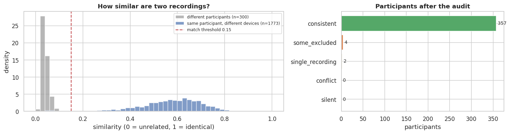
</p>

The two distributions are cleanly separated. The audit **confirmed 357 of 363 participants**
and removed **seven foreign or unmatched files** (4 matched no other device of their
participant, 3 were duplicates holding another session). Only 20 of 1,773 same-participant
pairs fell below the threshold.

### 5.3 Cough segmentation

Sessions are cut into single coughs with **Zhang et al.'s CLAP-based extractor** [4, 15]:

```
 4 recordings of one session
        │
 (1) ALIGN       shift every device so all four line up in time (cross-correlation)
        │
 (2) DETECT      cut the reference recording into 2-s windows and ask CLAP, zero-shot:
                 "white noise", "people talking" or "coughing sound"?
                 skip the ID announcement and quiet windows
        │
 (3) SINGLES     the first three groups of cough windows are the three single coughs;
                 trim each to its loud part with the energy envelope
        │
 (4) EPISODE     remaining cough windows form the multi-cough burst; find each cough as a
                 peak in the energy envelope; keep it only if ≥ half the devices agree
        │
 (5) KEEP        clips shorter than 1 s, cut at the SAME times on every device
```

<p align="center">
  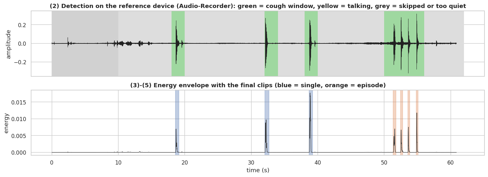
</p>

Because every device is cut at identical times, **clip *k* is the same physical cough on
every phone**. That pairing is what makes the device analysis in [§9](#9-why-cough-features-transfer-poorly-embedding-analysis) possible.

Our changes to the extractor move no cut point; they make it faster and record more:

| Change | Effect |
|---|---|
| FFT-based cross-correlation instead of direct correlation | Same shift, about 100–200× faster on long sessions |
| CLAP batched on GPU, only for windows passing the loudness gate | Same labels, much faster |
| Per-device alignment score recorded | Suspect sessions can be reviewed |
| Cough type (single vs episode) and artificial-join flag recorded | Available for later analysis |

**Segmentation output:** 7,314 clips from 359 participants in 12.1 minutes; 4 participants
yielded no clips, and no episode clip straddles an artificial join (0 of 3,991).

<details>
<summary><b>Segmentation quality checks</b></summary>

<p align="center">
  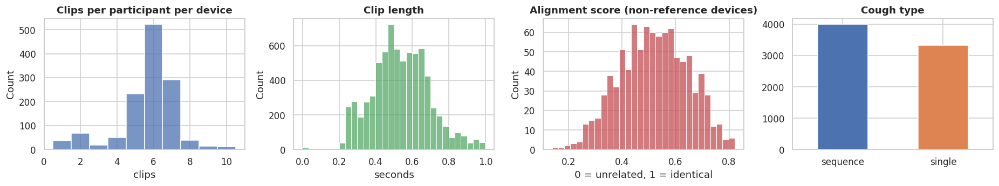
</p>

The lowest 2 % of alignment scores (≤ 0.268) are saved to `suspect_alignment.csv` for
listening.

</details>

### 5.4 Analysis cohort

Following Zhang et al., we keep **Chawama and Kanyama** (Chainda-South had a single
TB-positive participant with audio) and **Phones A, B and C** (the recorder covered too few
participants). Our cohort closely matches the published one:

| Site | Phone | Participants | Clips | TB rate | Zhang et al.: participants / clips / TB rate |
|---|---|---:|---:|---:|---|
| Chawama | A | 108 | 632 | 9.3 % | 111 / 687 / 9 % |
| Chawama | B | 101 | 589 | 9.9 % | 102 / 595 / 10 % |
| Chawama | C | 108 | 629 | 9.3 % | 109 / 635 / 9 % |
| Kanyama | A | 206 | 1,117 | 21.8 % | 207 / 1,158 / 22 % |
| Kanyama | B | 212 | 1,155 | 22.2 % | 214 / 1,229 / 22 % |
| Kanyama | C | 213 | 1,165 | 22.1 % | 214 / 1,205 / 22 % |

**Reproduction cohort: 325 participants (57 TB-positive), 5,287 clips.**
A stricter *paired cohort* of participants with clips on all three phones holds 299
participants (55 TB-positive).

### 5.5 From a cough clip to a model input

1. **Pad or crop** each clip to **0.96 s** (the input length VGGish was trained on).
2. **Mel spectrogram:** 25 ms windows every 10 ms, **64 mel bands from 100 to 8,000 Hz**,
   converted to decibels → a `64 × 97` image (pitch × time).
3. **Resize** to `96 × 64` (time × mel) for VGGish.

The training set additionally goes through two steps, **on training participants only**:

- **Balancing.** Clips are oversampled so every combination of phone × site × TB status is
  equally common (917 clips per cell, 11,004 in total). Otherwise the model could learn
  "Kanyama means more TB".
- **Augmentation.** Each oversampled copy is altered with a random mix of pitch shift
  (±4 semitones), piecewise speed perturbation (±10 %) and additive noise (10 dB SNR).

<p align="center">
  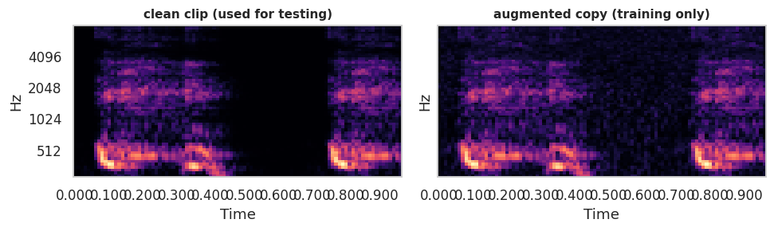
</p>

*What the model sees.* Time runs left to right over 0.96 s, mel frequency bottom to top, and
brightness is loudness in dB. The bright bands below 1 kHz and around 2 kHz are the cough's
harmonic structure. The right-hand copy is a training-only augmentation of the same clip.

## 6. Models

The study design has several arms. Two are complete on Zambia, and they are the subject of
this README.

| Arm | Inputs | Model | Status |
|---|---|---|---|
| **B** | 9 questionnaire answers | Regularised logistic regression | ✅ Complete |
| **C1 (audio-only ablation)** | Cough clips | **VGGish**, fine-tuned | ✅ Complete |
| A1 | Cough clips | MFCC network | Planned (CODA) |
| A2 / A3 | Cough clips | Frozen HeAR / OPERA embeddings | Next |
| A4 | Cough clips | HeAR + LoRA | Planned (CODA) |
| **A (fusion)** | Questionnaire + cough | Two-layer MLP, or a single out-of-fold audio score added to the logistic regression (a zero audio weight recovers B) | Next |

We started with VGGish rather than the proposed MFCC network because a published Zambia result
exists for it, which provides a **reproduction check** of the whole pipeline.

### 6.1 Model B: questionnaire only

A logistic regression on nine variables mapped exactly as in Zhang et al.: age, sex, smoking,
HIV status, previous TB, cough duration (in days), fever, weight loss and night sweats.
`C ∈ {0.01, 0.1, 1, 10, 100}` and `max_iter ∈ {100, 500, 1000}` are tuned by 4-fold
cross-validation inside each training fold. Age and cough duration are standardised **inside
each training fold** (Zhang et al. standardised on all data before splitting).

<p align="center">
  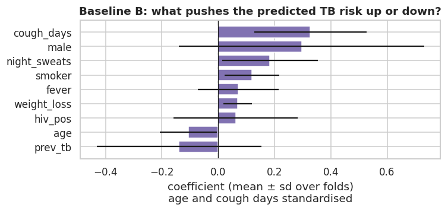
</p>

Cough duration, male sex and night sweats carry the largest positive coefficients. The wide
error bars on sex, HIV status and previous TB show how much the fit varies between folds of a
325-person cohort.

### 6.2 Model C1: VGGish cough model

<picture>
  <source media="(prefers-color-scheme: dark)" srcset="figures/architecture-dark.svg">
  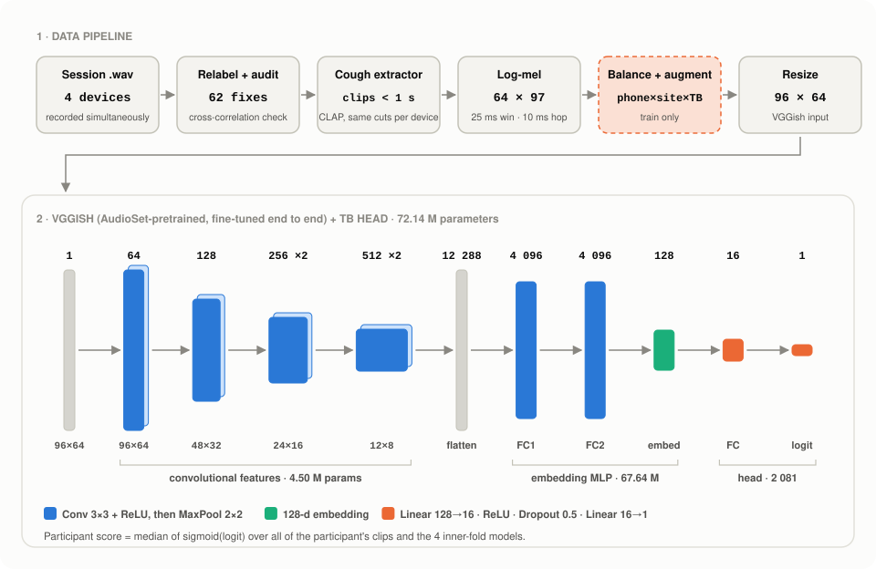
</picture>

**VGGish** [6] is a VGG-style convolutional network trained by Google on AudioSet (YouTube
sound clips) to produce a 128-dimensional audio embedding. We load the pretrained weights and
**fine-tune the whole network** on cough clips, with a small head on top that outputs one TB
logit. Each repeated convolutional unit is:

```
Conv2d 3×3 (stride 1, padding 1) → ReLU          ×1, ×1, ×2, ×2 per stage
MaxPool2d 2×2                                     after each stage
```

| Layer | Output shape (C × T × F) | Parameters |
|---|---|---:|
| Input (log-mel, resized) | 1 × 96 × 64 | — |
| Conv1 3×3, 64 → pool | 64 × 48 × 32 | 640 |
| Conv2 3×3, 128 → pool | 128 × 24 × 16 | 73,856 |
| Conv3 3×3, 256 | 256 × 24 × 16 | 295,168 |
| Conv4 3×3, 256 → pool | 256 × 12 × 8 | 590,080 |
| Conv5 3×3, 512 | 512 × 12 × 8 | 1,180,160 |
| Conv6 3×3, 512 → pool | 512 × 6 × 4 | 2,359,808 |
| Flatten | 12,288 | — |
| FC1 + ReLU | 4,096 | 50,335,744 |
| FC2 + ReLU | 4,096 | 16,781,312 |
| FC3 + ReLU (embedding) | 128 | 524,416 |
| Head: Linear + ReLU + Dropout 0.5 | 16 | 2,064 |
| Head: Linear (TB logit) | 1 | 17 |
| **Total** | | **72,143,265** |

The backbone holds 72,141,184 parameters (4.50 M convolutional, 67.64 M fully connected) and
the head 2,081. All 18 pretrained tensors are loaded **by name** with a strict check.

**Design choices.**

- **Pretrained VGGish, fine-tuned end to end.** Only 57 TB-positive participants are available,
  far too few to learn audio features from scratch; AudioSet pretraining supplies generic
  acoustic features. It also matches the published Zambia baseline we reproduce.
- **A tiny head (128 → 16 → 1) with dropout 0.5.** Keeps the number of newly initialised
  parameters small, and the backbone and head use different learning rates.
- **Participant-level scoring.** A participant's score is the **median** probability over all
  their clips and all four inner-fold models, which is robust to the occasional badly cut clip.

### 6.3 Training recipe (C1)

| Setting | Value |
|---|---|
| Loss | `BCEWithLogitsLoss` with `pos_weight = #neg / #pos` (class-weighted) |
| Optimiser | Adam; lr 1e-4 for VGGish, 1e-5 for the head |
| Scheduler | `ReduceLROnPlateau` on validation AUROC, factor 0.5, patience 2 |
| Batch size | 32 |
| Epochs | Up to 40, early stopping after 5 epochs without improvement in validation AUROC |
| Regularisation | Mixup (α = 0.1), dropout 0.5 in the head, balanced and augmented training pool |
| Model selection | Best-epoch weights restored (a true copy of the state dict) |
| Ensemble | 4 inner-fold models per outer test fold → **40 models** in total (2 repeats × 5 folds × 4) |
| Hardware | Kaggle GPU (notebook configured for a single T4); about 5–8 min per outer fold |
| Seed | 42 (fold-specific seeds derived from it) |

**Three defects fixed in the published training code.** Between our two full runs we found and
fixed three problems in the reference implementation; please keep them in mind when comparing
numbers:

1. **Weight loading by shape.** Pretrained tensors were copied into the model by matching
   *shapes*. Several layers share a bias shape, so **four VGGish bias vectors stayed random and
   four others received another layer's bias**. We load by name and verify all 18 tensors.
2. **Best epoch never restored.** The "best" weights were saved with `model.state_dict()`
   without copying; in PyTorch that dictionary points at the live weights, so "restoring" it
   restored the *last* epoch. We save a deep copy.
3. **Test clips augmented and duplicated.** The balanced, augmented set was built *before*
   splitting, so test clips were augmented and oversampled. We augment training clips only and
   **test on clean clips**.

## 7. Evaluation protocol

- **Participant-disjoint folds.** Participants, never individual clips, are split into
  **5 folds stratified by site and TB status, repeated twice** (10 test sets). If one person's
  coughs appeared in both training and test sets, a model could recognise the *person* rather
  than the disease.
- **Shared folds.** Every model uses the **same saved folds** (`folds.csv`), so every
  comparison is *paired*: the same people, scored by two models.
- **Nested validation.** Within each training fold, 4 inner folds provide validation sets for
  early stopping (audio) and hyperparameter search (clinical).

<p align="center">
  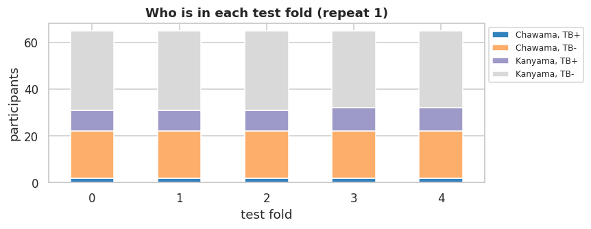
</p>

**Metrics.**

| Metric | Meaning |
|---|---|
| **AUROC** | Probability that a randomly chosen TB patient receives a higher score than a randomly chosen non-TB patient; 0.5 is chance. Reported as mean ± s.d. over the 10 test folds. |
| **Specificity at 90 % sensitivity** | Share of non-TB patients spared a laboratory test when the model catches nine of every ten TB cases (the WHO triage target is ≥ 70 %). |
| **Paired Δ AUROC** | Difference between two models on the same participants, with a **DeLong** 95 % CI and p-value [14], cross-checked by a 2,000-sample bootstrap. |

## 8. Results

### 8.1 Baseline reproduction

<picture>
  <source media="(prefers-color-scheme: dark)" srcset="figures/baseline-auroc-dark.svg">
  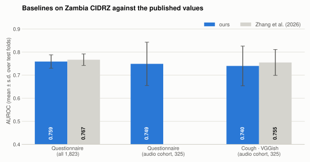
</picture>

| Model | Participants (TB+) | AUROC (ours) | AUROC (Zhang et al. [4]) | Spec. @ 90 % sens. |
|---|---|---:|---:|---:|
| B · questionnaire, all participants | 1,823 (205) | 0.759 ± 0.029 | 0.767 ± 0.025 | — |
| B · questionnaire, audio cohort | 325 (57) | **0.749 ± 0.094** | — | 0.358 |
| C1 · cough, VGGish | 325 (57) | **0.740 ± 0.086** | 0.755 ± 0.056 | 0.354 |

Both baselines land **within one standard deviation of the published values**, and every
number comes from our own runs. Note that the published audio and clinical numbers were
measured on different groups of people (about 650 versus 1,823), so they cannot be compared
with each other directly; ours can.

### 8.2 Cough alone ties with the questionnaire

<p align="center">
  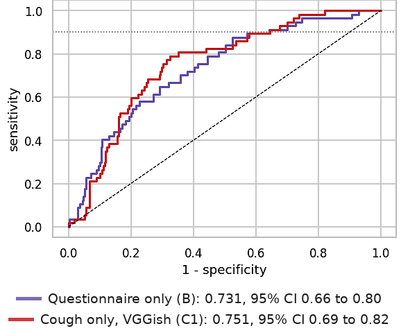
</p>

Paired comparison on the **same 325 participants** (Δ = cough − questionnaire):

| Repeat | AUROC cough | AUROC questionnaire | Δ | DeLong 95 % CI | Bootstrap 95 % CI | p |
|---|---:|---:|---:|---|---|---:|
| 1 | 0.751 | 0.731 | +0.020 | [−0.069, 0.109] | [−0.067, 0.112] | 0.657 |
| 2 | 0.713 | 0.717 | −0.004 | [−0.094, 0.086] | [−0.098, 0.087] | 0.929 |

The two models are statistically indistinguishable. At 90 % sensitivity both reach only
**35–36 % specificity**, so either model would still send about **64 of every 100 non-TB
patients** for a laboratory test, well short of the WHO's 70 % target. The cough carries some
TB information, but no more than the questionnaire, which raises the question of what *else*
its features carry.

<p align="center">
  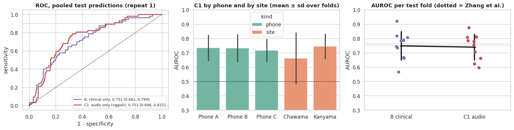
</p>

C1 performs similarly on each phone, but its Chawama estimate is very noisy (only 10
TB-positive participants).

### 8.3 The same cough, a different score on each phone

Because clip *k* is the same physical cough on every phone, we can score each participant
separately from their Phone A, B and C clips. A model listening only to the cough would put
every point on the diagonal.

<p align="center">
  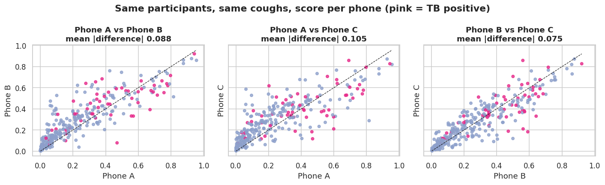
</p>

The fine-tuned model scores the same participants differently on each phone, by **0.075 to
0.105 on average** (on a 0–1 scale), even though every model was trained on all three phones.

### 8.4 Sensitivity to the data split

Our two full runs differ mainly in fold assignment (the audit and fixes changed a dozen files
but reshuffled every fold). Yet the cough model moved from **0.761 to 0.740**, and an apparent
triage advantage for cough (42 % vs 24 % specificity at 90 % sensitivity) **disappeared**
(35 % vs 36 %). With 57 TB-positive participants, differences below about **0.05 AUROC cannot
be detected**, and Chawama, with only 10 TB-positive participants, is too small to analyse on
its own.

## 9. Why cough features transfer poorly: embedding analysis

The second notebook ([`notebooks/02_embedding_analysis.ipynb`](notebooks/02_embedding_analysis.ipynb))
asks what the cough features actually encode. Every clip is represented in two ways:

- **Spectrogram summary:** mean and standard deviation of each of the 64 mel bands (128
  numbers, nothing learned).
- **VGGish embedding:** the 128-d output of the **pretrained** VGGish, before any TB
  fine-tuning.

A linear classifier, always **tested on participants it never saw** (5-fold
`StratifiedGroupKFold`), then tries to recover the phone or the TB status.

### 9.1 Recording conditions dominate the features

<picture>
  <source media="(prefers-color-scheme: dark)" srcset="figures/probe-dark.svg">
  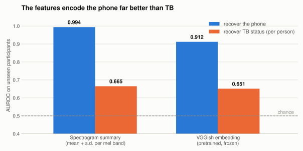
</picture>

| Features | Phone accuracy (chance 0.33) | Phone AUROC | TB AUROC per clip | TB AUROC per person |
|---|---:|---:|---:|---:|
| Spectrogram summary | 0.955 | **0.994** | 0.642 | 0.665 |
| VGGish embedding (pretrained) | 0.772 | **0.912** | 0.601 | 0.651 |

The phone is recovered **almost perfectly** from simple spectrogram statistics and well from
VGGish, whereas TB status is recovered only weakly. A two-dimensional t-SNE map of all 5,287
VGGish embeddings tells the same story:

<table>
  <tr>
    <td width="50%">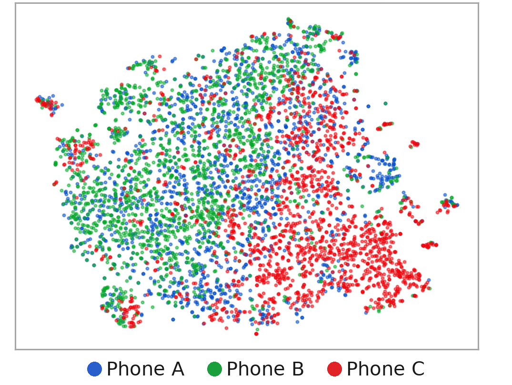</td>
    <td width="50%">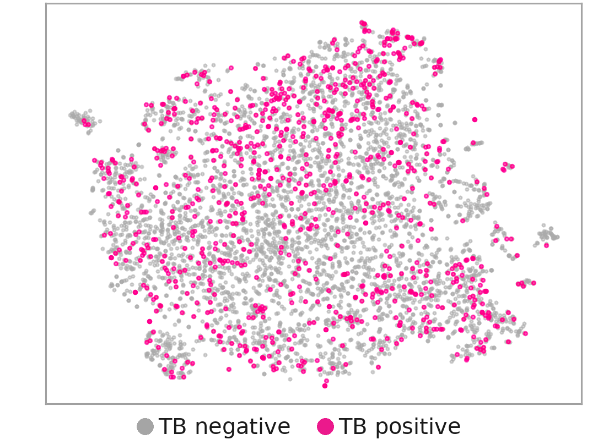</td>
  </tr>
  <tr>
    <td align="center"><b>(a)</b> Coloured by phone</td>
    <td align="center"><b>(b)</b> Coloured by TB status</td>
  </tr>
</table>

Phone C occupies its own region, Phones A and B overlap (consistent with their similar spectra
in [§4.2](#42-what-does-the-audio-look-like)), and TB-positive clips are spread throughout.

### 9.2 Does changing the phone change a cough more than changing the person?

Only a simultaneously recorded dataset can ask this. We compare cosine distances between four
kinds of clip pairs:

<p align="center">
  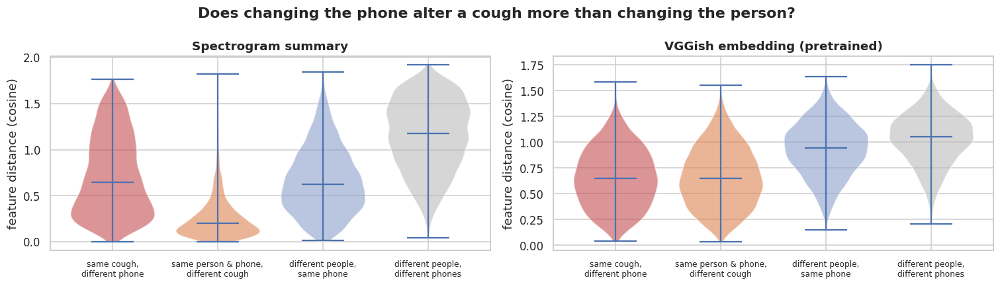
</p>

| Pair type (median cosine distance) | Spectrogram summary | VGGish embedding |
|---|---:|---:|
| Same cough, different phone | 0.645 | 0.647 |
| Same person and phone, different cough | 0.198 | 0.647 |
| Different people, same phone | 0.626 | 0.945 |
| Different people, different phones | 1.175 | 1.051 |
| Same-cough pairs farther apart than a typical different-person pair | 51.3 % | 17.4 % |

For spectrogram statistics, **moving one cough to another phone changes it as much as
swapping in a different person** (0.645 vs 0.626). VGGish is more robust, but even there the
same cough on two phones is as far apart as two different coughs from one person. The effect
is strongest between Phone A and Phone C (median 1.005 for spectrogram summaries, against 0.317
for A vs B).

### 9.3 Is the weak TB signal real, or is it the clinic?

Kanyama's TB rate is more than twice Chawama's, and the features partly reveal the clinic, so
a model could seem to detect TB by recognising Kanyama. Measuring AUROC **within** each clinic
removes that shortcut:

| Features | Recover site (AUROC) | TB, both sites | TB from site alone | TB within Chawama (10 TB+) | TB within Kanyama (47 TB+) |
|---|---:|---:|---:|---:|---:|
| Spectrogram summary | 0.729 | 0.664 | 0.599 | 0.476 | **0.692** |
| VGGish embedding | 0.591 | 0.652 | 0.599 | 0.572 | **0.651** |

<p align="center">
  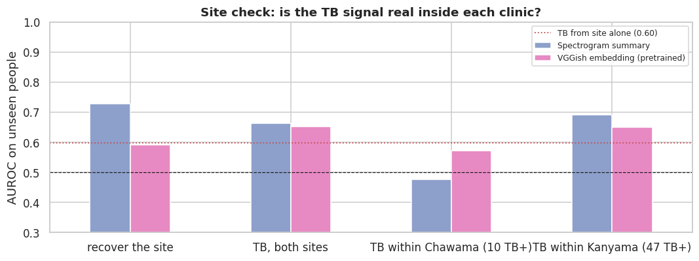
</p>

Within Kanyama alone, where the site shortcut gives no advantage, TB AUROC stays at
**0.65–0.69**: the TB signal is **real, although weak**. The Chawama estimate rests on 10
TB-positive participants and is not interpretable.

### 9.4 A first look at an unseen phone

As a preview of device hold-out, a linear probe is trained either on all three phones
("seen") or on the other two only ("unseen"), and tested on the same participants' clips from
the held-out phone:

| Features | Held-out phone | TB AUROC, phone seen | TB AUROC, phone unseen | Change | Mean score shift |
|---|---|---:|---:|---:|---:|
| Spectrogram summary | A | 0.697 | 0.671 | −0.026 | 0.064 |
| Spectrogram summary | B | 0.693 | 0.696 | +0.003 | 0.044 |
| Spectrogram summary | C | 0.673 | 0.620 | **−0.053** | **0.126** |
| VGGish embedding | A | 0.667 | 0.642 | −0.025 | 0.043 |
| VGGish embedding | B | 0.655 | 0.651 | −0.004 | 0.037 |
| VGGish embedding | C | 0.604 | 0.575 | −0.029 | 0.099 |

Removing a phone from training lowers TB AUROC on that phone, and the drop and the shift in
predicted risk are largest for **Phone C**, the phone whose recordings differ most from the
others (§9.1–9.2).

## 10. Discussion, limitations and risks

**Implications for country shift.** Cough audio holds a *real but weak* TB signal next to a
*much stronger* signal from the recording conditions. Within one dataset a model tolerates that
imbalance. But countries differ in phones, clinics and recording environments, so under
country hold-out the strong signal shifts while the weak one must carry the prediction. This
is a plausible mechanism behind drops such as the Peruvian external validation [3], and the
reason the gain Δ must be measured on unseen countries.

**Limitations and risks.**

| Area | Issue | Mitigation |
|---|---|---|
| Sample size | 57 TB-positive participants make intervals wide; differences < 0.05 AUROC are undetectable. | Paired tests on shared folds; report CIs; merge the smallest CODA countries if needed. |
| Attribution | Country hold-out mixes device, clinic, recruitment and severity; Zambia isolates device fully and clinic only in part. | Interpret Δ alongside the device and site analyses. |
| Segmentation | The CLAP detector is zero-shot and has never been validated against hand labels. | Per-device alignment scores; spot-check the lowest 2 % by ear. |
| Data access | CODA is controlled; our Intended Data Use statement is submitted and faculty sign-off is being requested. | Pipeline is built on Zambia so it can run on CODA unchanged. |
| Compute | The 395 GB Kenyan TBscreen dataset [5] exceeds our storage and GPU budget. | Not used as a further external test. |

## 11. Next steps

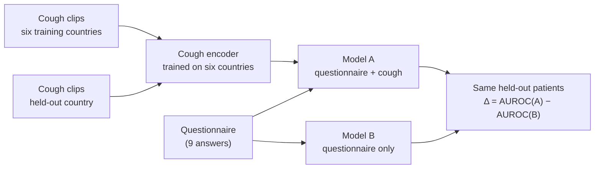

*Leave-one-country-out design on CODA, with Zambia as an external eighth country. Model B sees
no audio, so changes in Δ between countries reflect the cough pathway.*

1. **Now, on Zambia:** build the fusion Model A and the HeAR and OPERA embeddings (arms A2,
   A3), so they run on CODA unchanged.
2. **On receiving CODA:** check per-country class balance, then run arms B and A1–A3 under
   random and leave-one-country-out splits; report Δ per held-out country together with mean
   and worst-country AUROC and specificity at a threshold fixed on the training countries.
   Arm A4 then tests whether LoRA adaptation to six countries helps or harms the seventh,
   followed by an attention-pooling ablation.
3. **External test:** evaluate the CODA models on Zambia using the nine clinical variables both
   datasets share.

## 12. Repository structure

```
IDL_F26_CoughTB/
├── README.md                          # this document
├── docs/
│   └── progress_report.pdf            # 6-page progress report (NeurIPS format)
├── notebooks/
│   ├── 01_zambia_baseline.ipynb       # inventory, EDA, audit, segmentation, cohort, folds, Baselines B and C1
│   └── 02_embedding_analysis.ipynb    # phone vs TB probes, t-SNE, site check, same-cough distances, unseen phone
├── figures/
│   ├── architecture-{light,dark}.svg  # pipeline + VGGish diagram (generated)
│   ├── baseline-auroc-{light,dark}.svg
│   ├── probe-{light,dark}.svg
│   ├── *.png                          # figures from the progress report
│   └── notebook/                      # figures exported from the two notebooks
├── scripts/
│   └── make_figures.py                # regenerates the SVG figures
└── .gitignore
```

The Zambia audio, the segmented clips, features and model weights are **not included**; they
are produced by the notebooks from the original dataset.

## 13. Reproducing the results

Both notebooks are written for **Kaggle** and save every expensive intermediate as a zipped
"bundle" so later runs can resume.

**Notebook 01: baselines** ([`notebooks/01_zambia_baseline.ipynb`](notebooks/01_zambia_baseline.ipynb))

1. Create a Kaggle notebook from the file and **Add data** `googlehealthai/google-health-ai`.
2. Accelerator: **GPU T4** (one is enough). **Internet: on** (CLAP package and weights,
   VGGish weights, relabelling log).
3. Run once with `FAST_MODE = True` (≈ 1–2 h end to end), then with `FAST_MODE = False` for the
   full protocol (2 × 5 outer folds × 4 inner models).
4. Outputs in `/kaggle/working/export/`:

| Bundle | Contents |
|---|---|
| `zambia_segmented_coughs.zip` | every cough clip, manifest, QC tables |
| `zambia_metadata_cohort.zip` | harmonised clinical variables, cohorts, **shared folds** |
| `zambia_features_mel.zip` | clean and augmented log-mel features with indexes |
| `zambia_baseline_results.zip` | out-of-fold scores, per-fold AUROCs, paired comparison, all figures |

To skip recomputation in a later run, attach a saved bundle and set `SEGMENTED_INPUT` or
`FEATURES_INPUT` in the `CFG` cell.

**Notebook 02: embedding analysis** ([`notebooks/02_embedding_analysis.ipynb`](notebooks/02_embedding_analysis.ipynb))

1. Add the dataset holding `zambia_features_mel.zip` from Notebook 01 and point
   `CFG["FEATURES_INPUT"]` at it.
2. No GPU is needed (a few minutes on CPU). Internet on to download the VGGish weights.

**Figures.** To rebuild the generated SVGs:

```bash
pip install matplotlib
```

```bash
python scripts/make_figures.py
```

## 14. References

1. World Health Organization. *High-Priority Target Product Profiles for New Tuberculosis Diagnostics.* WHO, 2014.
2. D. Jaganath et al. "Accelerating cough-based algorithms for pulmonary tuberculosis screening: Results from the CODA TB DREAM Challenge." *Open Forum Infectious Diseases* 12(10), 2025.
3. A. J. Zimmer et al. "External validation of cough-based algorithms for pulmonary tuberculosis screening from the CODA TB DREAM Challenge using cough data from Peru." *Scientific Reports*, 2026.
4. W. Zhang, T. Teijeiro, J. Thevenot, D. Atienza. "Why ML-based cough models do not generalize: A systematic cross-dataset evaluation for tuberculosis screening." arXiv:2608.25846, 2026. Code: [esl-epfl/tb-cough-generalization](https://github.com/esl-epfl/tb-cough-generalization).
5. M. Sharma et al. "TBscreen: A passive cough classifier for tuberculosis screening with a controlled dataset." *Science Advances* 10(1), 2024.
6. S. Hershey et al. "CNN architectures for large-scale audio classification." *ICASSP*, 2017.
7. S. Baur et al. "HeAR: Health acoustic representations." arXiv:2403.02522, 2024.
8. Y. Zhang et al. "Towards open respiratory acoustic foundation models: Pretraining and benchmarking." *NeurIPS Datasets and Benchmarks*, 2024.
9. E. J. Hu et al. "LoRA: Low-rank adaptation of large language models." *ICLR*, 2022.
10. H. Coppock et al. "Audio-based AI classifiers show no evidence of improved COVID-19 screening over simple symptoms checkers." *Nature Machine Intelligence* 6(2), 2024.
11. G. P. Kafentzis, E. Selisios. "Tuberculosis screening from cough audio: Baseline models, clinical variables, and uncertainty quantification." *Sensors* 26(4), 2026.
12. R. A. Buyung, W. Nugroho. "Multimodal deep learning for tuberculosis detection using cough audio and clinical data with health acoustic representations (HeAR)." *IJACSA* 16(10), 2025.
13. S. Huddart et al. "Solicited cough sound analysis for tuberculosis triage testing: The CODA TB DREAM Challenge dataset." *Scientific Data* 11, 2024.
14. E. R. DeLong, D. M. DeLong, D. L. Clarke-Pearson. "Comparing the areas under two or more correlated receiver operating characteristic curves: A nonparametric approach." *Biometrics* 44(3), 1988.
15. B. Elizalde, S. Deshmukh, H. Wang. "Natural language supervision for general-purpose audio representations." *ICASSP*, 2024.

## 15. Acknowledgements

- The **Zambia CIDRZ** cough data were collected by CIDRZ with Google Health AI and are
  distributed on Kaggle (`googlehealthai/google-health-ai`). They are not redistributed here.
- The cough extractor, relabelling log and VGGish training recipe come from **Zhang et al.
  (2026)**, [esl-epfl/tb-cough-generalization](https://github.com/esl-epfl/tb-cough-generalization)
  (MIT licence). Where we changed their code, the notebook says exactly what and why.
- Pretrained VGGish weights: [harritaylor/torchvggish](https://github.com/harritaylor/torchvggish).
- Course staff of Introduction to Deep Learning at Carnegie Mellon University.

**Team:** Martin Koome, Odunayo Akinlade, Yusuf Olaniyi, Michael Quaicoe
(work areas: data and audit; encoders; fusion; evaluation).
