# Does Cough Audio Add Value Under Country Shift?

**Tuberculosis triage from cough recordings across CODA TB DREAM (7 countries), Zambia CIDRZ and Kenya TBscreen**

Martin Koome · Odunayo Akinlade · Yusuf Olaniyi · Michael Quaicoe
Carnegie Mellon University · 11-785 Introduction to Deep Learning (Fall 2026) · Course project

Smartphone cough recordings have been proposed as a cheap, specimen-free way to screen for
tuberculosis (TB), but models that work in one study often fail in another. We ask whether
cough audio adds anything to the questions a health worker already asks **when the model is
used in a country it was not built in**. The outcome is the paired gain
Δ = AUROC(questions + cough) − AUROC(questions) on the same held-out people.

**Where we stand (10 November 2026).** Baselines are complete on all three datasets, and each
one reproduces the published result it can be compared with. On CODA, holding out one country
at a time, **adding the cough gains +0.008 AUROC (95 % CI −0.00 to +0.02, p = 0.12)**. In
Madagascar it *lowers* AUROC by 0.076, and inside a new country the cough alone scores
**0.506**, essentially a coin flip. Meanwhile a linear probe can name the **country from a single
cough at AUROC 0.90**, even though every CODA site used the same app. Recording context, not
disease, dominates what the cough features encode.

<p align="left">
  
  
  
  
  
  
</p>

> **Data notice.** CODA TB DREAM is a controlled-access dataset. This repository contains **code
> and aggregate results only**: no audio, embeddings, participant-level tables or predictions
> from any dataset. See [Datasets and data governance](#3-datasets-and-data-governance) before
> sharing this repository more widely.

---

## Key findings so far

| # | Finding | Evidence |
|---|---|---|
| 1 | **The pipeline is sound.** All three datasets reproduce published results. | Zambia VGGish 0.740 vs 0.755 published; Kenya fine-tuned VGGish 0.658 per cough vs 0.661; CODA cough 0.684 vs the challenge's 0.69–0.74 |
| 2 | **The questions carry most of the signal.** | CODA questions alone 0.731; with CODA's four extra variables 0.810, already inside the challenge's cough + clinical range (0.78–0.83) |
| 3 | **Within one population the cough gain is real but tiny.** | CODA random split Δ = +0.014 (+0.00 to +0.02, p = 0.01); Zambia +0.019; Kenya −0.006 |
| 4 | **In a new country the gain disappears, and can reverse.** | CODA leave-one-country-out Δ = +0.008 (p = 0.12); Madagascar −0.076 (−0.12 to −0.04) |
| 5 | **Inside a new country the cough alone is near chance.** | Mean within-country cough AUROC 0.506 (VGGish), 0.535 (spectrogram), 0.546 (MFCC) |
| 6 | **A cough reveals its recording context far better than TB.** | Phone in Zambia 0.99; Zambia vs Kenya 0.986; country within CODA 0.90–0.94; TB from the same features 0.65–0.68 |
| 7 | **The questions also travel imperfectly, but lose less.** | CODA questions drop 0.04 to a new country; the cough drops 0.13–0.18 |
| 8 | **Decision thresholds do not travel.** | A 90 %-sensitivity threshold set on six countries clears 0 % of non-TB patients in Madagascar and 7 % in Uganda |

<picture>
  <source media="(prefers-color-scheme: dark)" srcset="figures/gain-forest-dark.svg">
  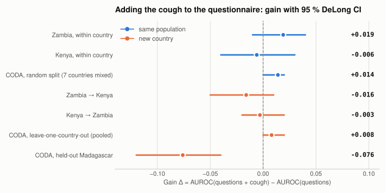
</picture>

---

## Contents

1. [Motivation and research question](#1-motivation-and-research-question)
2. [Background and related work](#2-background-and-related-work)
3. [Datasets and data governance](#3-datasets-and-data-governance)
4. [The four notebooks](#4-the-four-notebooks)
5. [Shared methods](#5-shared-methods)
6. [Part I · Zambia CIDRZ: pipeline and baselines](#6-part-i--zambia-cidrz-pipeline-and-baselines)
7. [Part II · Kenya TBscreen: a second country](#7-part-ii--kenya-tbscreen-a-second-country)
8. [Part III · CODA: leave-one-country-out](#8-part-iii--coda-leave-one-country-out)
9. [Synthesis across the three datasets](#9-synthesis-across-the-three-datasets)
10. [Discussion, limitations and risks](#10-discussion-limitations-and-risks)
11. [Roadmap: the final four weeks](#11-roadmap-the-final-four-weeks)
12. [Repository structure](#12-repository-structure)
13. [Reproducing the results](#13-reproducing-the-results)
14. [References](#14-references)
15. [Acknowledgements](#15-acknowledgements)

---

## 1. Motivation and research question

TB is the leading infectious cause of death worldwide, and confirming it usually requires
sputum and a laboratory. The WHO has therefore prioritised a **non-sputum triage test** that
decides who should be sent for confirmation, with a target of **≥ 90 % sensitivity and
≥ 70 % specificity** [1]. Cough-based models look promising inside a single study: the CODA TB
DREAM Challenge reported AUROC 0.78 to 0.83 for cough combined with routine clinical
variables [2]. Yet external validation in Peru reported only 0.48 to 0.62 [3], and a
cross-dataset study found that learned cough representations cluster **by recording device
rather than by TB status** [4]. The clinics that would benefit most never contributed
training data, which is exactly where current models are least reliable.

**Research question.** When an entire country is excluded from model development, does adding
cough audio to routine clinical questions improve TB triage? Do health-specific encoders (HeAR,
OPERA) change the answer, and does adapting the encoder help or hurt in the held-out country?

**Quantity of interest.** The paired gain on the same held-out patients:

$$\Delta = \mathrm{AUROC}(\text{questionnaire} + \text{cough}) - \mathrm{AUROC}(\text{questionnaire})$$

**Design choices fixed in the proposal**, all still in use:

1. The gain Δ, not the AUROC, is the outcome, measured on the same people with DeLong intervals.
2. **Leave-one-country-out on CODA** is the main test: train on six countries, test on the seventh.
3. Health-specific audio encoders (HeAR, OPERA) are compared with general audio features (VGGish,
   spectrogram and MFCC summaries).
4. Frozen versus adapted encoders: does fine-tuning help in a new country, or does it learn the
   training countries?

While CODA access was pending we built and validated the pipeline on two other datasets, Zambia
and Kenya. They now serve as **external test countries**.

## 2. Background and related work

- **Zhang et al. [4]** are our closest reference. Across CODA, TBscreen and Zambia they report a
  within-Zambia AUROC of **0.755 ± 0.056** for a mel-spectrogram VGGish model and
  **0.767 ± 0.025** for logistic regression on clinical variables, and suggest, without testing
  it, that clinical variables could be a stable baseline to which audio adds information.
- **CODA TB DREAM** [2, 13]: challenge teams reached 0.69–0.74 for cough alone and 0.78–0.83 for
  cough plus clinical data; the Peru external test reached only 0.48–0.62 [3].
- **TBscreen** [5] (Kenya): fine-tuned VGGish 0.661 per cough and 0.744 per participant; their
  main scalogram ResNet18 reaches 0.793 per cough.
- **Candidate encoders.** HeAR, pretrained on 313 million unlabelled body-sound clips [7], and
  OPERA, an open respiratory encoder never benchmarked on TB [8]. LoRA [9] adapts them cheaply.
- **Confounding in cough AI.** COVID-19 cough classifiers fell from AUROC 0.85 to 0.62 once
  confounders were matched [10]. We follow the participant-disjoint cross-validation of [11].
- **Multimodal TB work.** HeAR has been combined with CODA clinical data [12], but with
  clip-level predictions on a balanced subset. We instead measure the *additional* value of
  audio for the *same* held-out patients.

## 3. Datasets and data governance

| | **CODA TB DREAM** | **Zambia CIDRZ** | **Kenya TBscreen** |
|---|---|---|---|
| Countries | Uganda, Philippines, Vietnam, Madagascar, South Africa, India, Tanzania | Zambia (Lusaka) | Kenya (Nairobi) |
| Participants with coughs | 1,082 | 325 (analysis cohort) | 148 |
| TB cases | 291 (27 %) | 57 (18 %) | 102 (69 %) |
| Study design | Consecutive adults with cough, all tested for TB | Clinic attendees (triage population) | Case-control: TB against other respiratory illness |
| Recordings | One app everywhere; 9,772 solicited coughs of 0.5 s | Three phones at once; 5,287 segmented coughs | Phone + two microphones in one room; natural and forced coughs |
| Reference standard | Xpert MTB/RIF Ultra and culture | Xpert and culture | Per TBscreen protocol [5] |
| Our role for it | **Main experiment** | Development set, external test country | External test country |
| Notebook | 04 | 01, 02 | 03 |

**Harmonising the questions.** All three datasets are reduced to the same **nine questions**:
age, sex, smoking, HIV status, previous TB, cough duration, fever, weight loss and night
sweats. Two definitions differ: smoking means *smoked in the last week* in CODA but *ever
smoked* elsewhere, and unknown HIV status is treated as missing. CODA also has four extra
variables (coughing blood, heart rate, temperature, BMI) that form an **extended questions**
model used only within CODA.

### Data access and what this repository contains

| Dataset | Access | In this repository |
|---|---|---|
| CODA TB DREAM [13] | **Controlled access** through Synapse (project `syn39711065`). All four team members are certified, and the data are used under our data use statement. | Code and **aggregate** outputs only: counts per country, AUROCs, intervals, figures, and the variable names from the data dictionary. |
| Zambia CIDRZ [7] | Kaggle dataset `googlehealthai/google-health-ai` | Code, aggregate outputs and figures. |
| Kenya TBscreen [5] | Read from the team's private storage | Code, aggregate outputs and figures. |

Rules the team follows for every notebook and export:

- **Never commit data.** No audio, spectrograms, embeddings, participant-level tables, per-participant
  predictions or fold files (`coda_folds.csv` lists participant IDs). `.gitignore` blocks the common formats.
- **Credentials stay out of code.** Storage access is read from the Kaggle secret
  `AZURE_STORAGE_CONNECTION_STRING`; each member uses a personal, read-only, expiring token.
- **Notebooks run privately on Kaggle**, and their export bundles contain aggregate tables and figures only.
- **Keep this GitHub repository private** until CODA's conditions for publications (citation,
  consortium acknowledgement, any review by data contributors) have been checked.

## 4. The four notebooks

| Notebook | Dataset | What it does | Runtime |
|---|---|---|---|
| [`01_zambia_baseline.ipynb`](notebooks/01_zambia_baseline.ipynb) | Zambia | Inventory, EDA, relabelling, recording audit, CLAP cough segmentation, cohort, shared folds, Baseline B (questions) and C1 (fine-tuned VGGish), paired comparison | GPU, ≈ 1.5–2 h full protocol |
| [`02_embedding_analysis.ipynb`](notebooks/02_embedding_analysis.ipynb) | Zambia | Phone vs TB probes, t-SNE maps, site check, same-cough distances across phones, unseen-phone test | CPU, minutes |
| [`03_kenya_tbscreen_baselines.ipynb`](notebooks/03_kenya_tbscreen_baselines.ipynb) | Kenya (+ Zambia) | Data map, harmonised questions, device pairing, verified stored spectrograms, baselines, fine-tuned VGGish reproduction, device probes, natural vs forced coughs, Zambia ↔ Kenya transfer | GPU, ≈ 0.9 h |
| [`04_coda_leave_one_country_out.ipynb`](notebooks/04_coda_leave_one_country_out.ipynb) | CODA | Participant table, EDA by country, held-out groups, 9,772 coughs as 0.5 s clips, MFCC / spectrogram / VGGish representations, random split, **leave-one-country-out**, frozen thresholds, country probe | GPU for one step |

All code cells in the four notebooks have been run and carry their outputs (notebook 04's
final cell is empty).

## 5. Shared methods

**Three models, the same in every notebook.**

| Model | Inputs | How |
|---|---|---|
| **B · questions only** | the nine shared questions (CODA: optionally the extended set) | Regularised logistic regression; variables whose missingness differs by more than 20 points between TB groups are excluded, because "missing" would act as a shortcut |
| **Cough only** | one feature vector per cough | Linear probe (logistic regression) per cough; a participant's score is the mean (CODA, Kenya) or median (Zambia) over their coughs. Notebook 01 instead fine-tunes the full VGGish |
| **A · questions + cough** | B's inputs plus the participant's out-of-fold cough score | Logistic regression; the cough score used in training comes from inner folds, so it is always a prediction for people the cough model did not see. A zero cough weight recovers B |

**Cough representations.**

| Representation | Size | Description |
|---|---|---|
| MFCC summary | 40 | Mean and spread of 20 MFCCs, the classic hand-crafted features (CODA) |
| Spectrogram summary | 128 | Mean and spread of each of 64 mel bands; nothing learned |
| VGGish (pretrained) | 128 | AudioSet-pretrained VGGish embedding [6], no TB training |
| VGGish (fine-tuned) | — | End-to-end fine-tuning on TB (Zambia notebook 01, Kenya notebook 03) |
| HeAR, OPERA | 512, — | Planned for Week 2 ([Roadmap](#11-roadmap-the-final-four-weeks)) |

**Evaluation.**

- **Participant-disjoint splits only.** A person's coughs never appear in both training and test data.
- **AUROC per participant**, with bootstrap intervals. Paired differences between models on the
  same people use **DeLong's test** [14].
- **Frozen threshold.** The threshold for 90 % sensitivity is fixed on the training data and
  applied unchanged to the test set, as a clinic would have to do.
- **Pooled versus within-country AUROC.** Pooled ranks all held-out people together;
  within-country computes AUROC inside each country and averages. If a model only recognises
  countries with more TB, the pooled number looks good while the within-country number sits near 0.5.

---

## 6. Part I · Zambia CIDRZ: pipeline and baselines

The Zambia dataset was our development set. Every participant was recorded by **four devices
at once** (an audio recorder and three phones: Pixel 3a, Galaxy A12, Galaxy A22), which makes
it possible to isolate the effect of the device.

### 6.1 Exploratory analysis

<p align="center">
  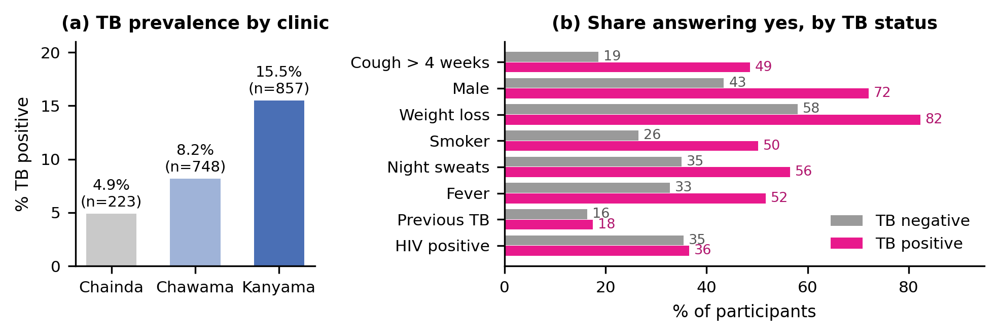
</p>

The metadata cover **1,828 adults** from three Lusaka clinics and **1,481 session recordings**.
TB prevalence differs sharply by clinic (all participants):

| Clinic | Participants | TB-positive | Prevalence |
|---|---:|---:|---:|
| Chainda-South | 223 | 11 | 4.9 % |
| Chawama | 748 | 61 | 8.2 % |
| Kanyama | 857 | 133 | 15.5 % |

**The questionnaire is a strong opponent.** Several answers separate TB-positive from
TB-negative participants clearly, while HIV status and previous TB barely differ:

| Item | TB-negative | TB-positive |
|---|---:|---:|
| Cough > 4 weeks | 19 % | 49 % |
| Male | 43 % | 72 % |
| Weight loss | 58 % | 82 % |
| Smoker | 26 % | 50 % |
| Night sweats | 35 % | 56 % |
| Fever | 33 % | 52 % |
| Previous TB | 16 % | 18 % |
| HIV positive | 35 % | 36 % |

**The devices sound different.** The same cough recorded at the same moment looks different on
each device; Phone C (high tier) keeps far more energy above 5 kHz than the others.

<p align="center">
  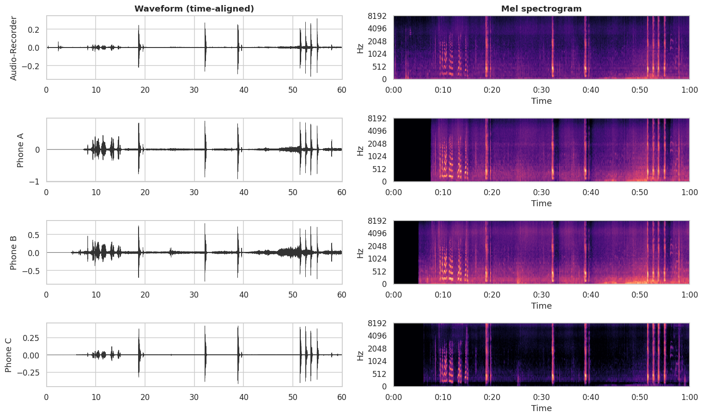
</p>
<p align="center">
  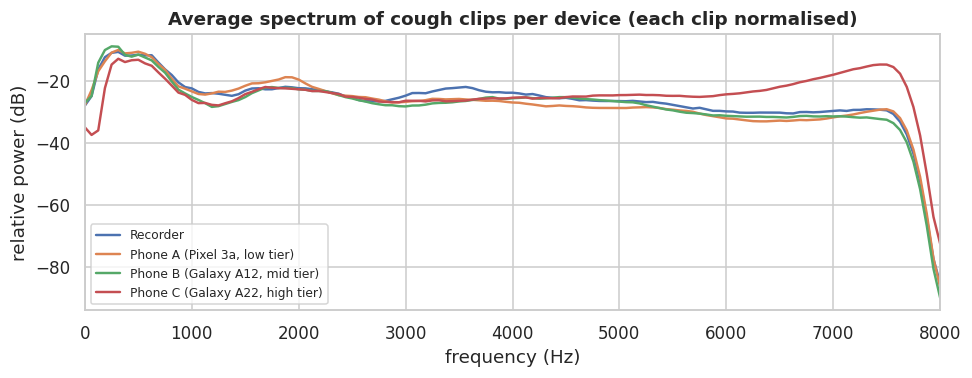
</p>

<details>
<summary><b>More Zambia EDA</b> (age, cough duration, missingness, device coverage, session length)</summary>

<p align="center">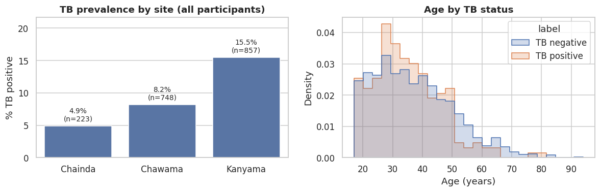</p>
<p align="center">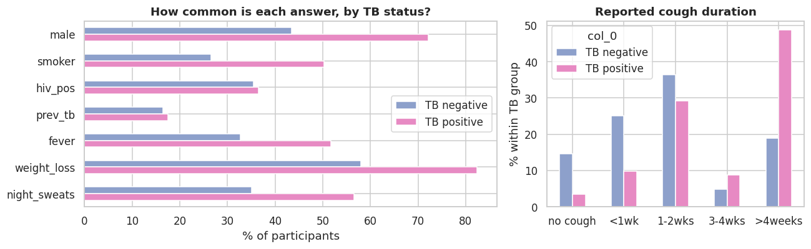</p>
<p align="center">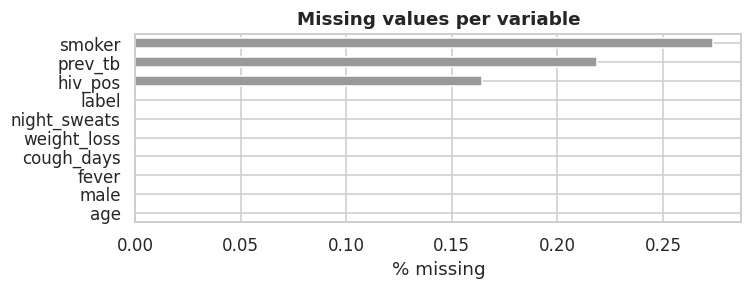</p>
<p align="center">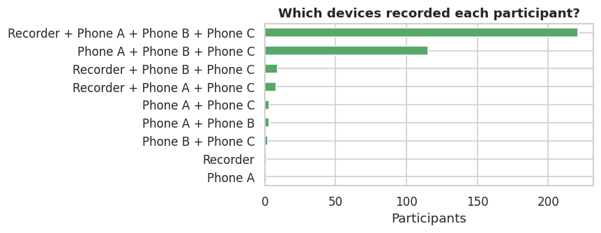</p>
<p align="center">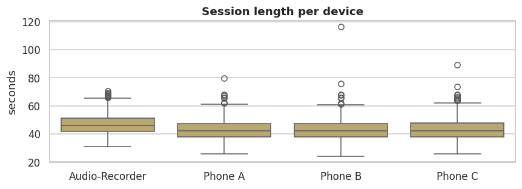</p>
<p align="center">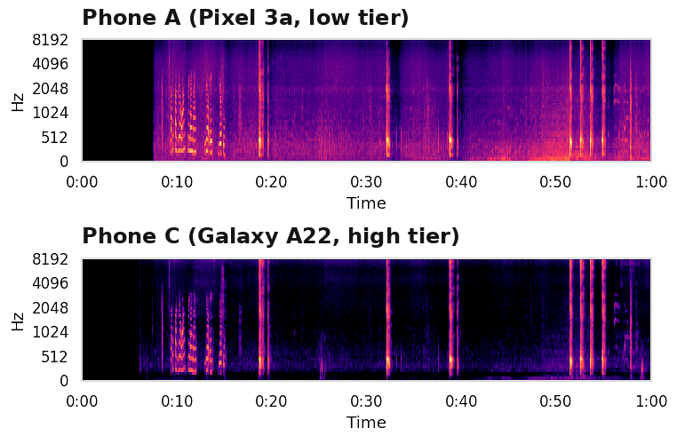</p>

All nine clinical variables are close to complete: 1,823 participants (205 TB-positive) have
every variable and a label, matching Zhang et al.

</details>

### 6.2 Data preparation pipeline

Nothing in the Zambia release is pre-cut into coughs or pre-linked to labels; the file path is
the only link between a sound and a person.

1. **Relabelling.** Zhang et al.'s **62 published filename corrections** (54 files changed),
   with chained entries resolved by looking each file up once by its original name.
2. **Recording audit (our addition).** Four devices recording one session line up closely under
   cross-correlation; a file holding someone else's session lines up with nothing. With a match
   threshold of 0.15 (unrelated pairs: median 0.038, 99th percentile 0.092), the audit
   **confirmed 357 of 363 participants** and removed **seven foreign or unmatched files**.
3. **Cough segmentation** with Zhang et al.'s CLAP-based extractor [4, 15]: align the devices,
   label 2-s windows zero-shot as cough / talking / noise, trim the three single coughs and the
   multi-cough burst, and keep clips under 1 s **cut at the same times on every device**, so clip
   *k* is the same physical cough on every phone. Output: 7,314 clips from 359 participants.
4. **Analysis cohort.** Chawama and Kanyama, Phones A, B and C: **325 participants (57 TB),
   5,287 clips**, within a few percent of Zhang et al.'s published counts.
5. **Model input.** Pad or crop to 0.96 s; 64-band log-mel spectrogram (25 ms window, 10 ms hop,
   100–8,000 Hz) → `64 × 97`, resized to `96 × 64`. Training clips only are balanced over
   phone × site × TB (917 per cell) and augmented (pitch shift, speed perturbation, noise).

<p align="center">
  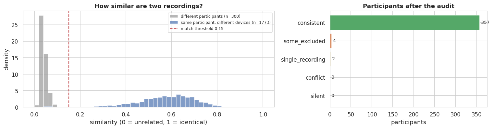
</p>
<p align="center">
  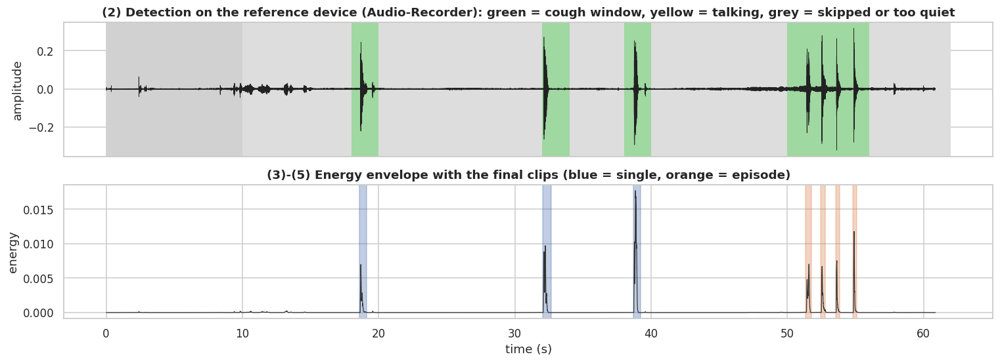
</p>

<details>
<summary><b>Segmentation quality checks, fold composition and the model input</b></summary>

<p align="center">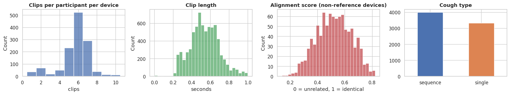</p>
<p align="center">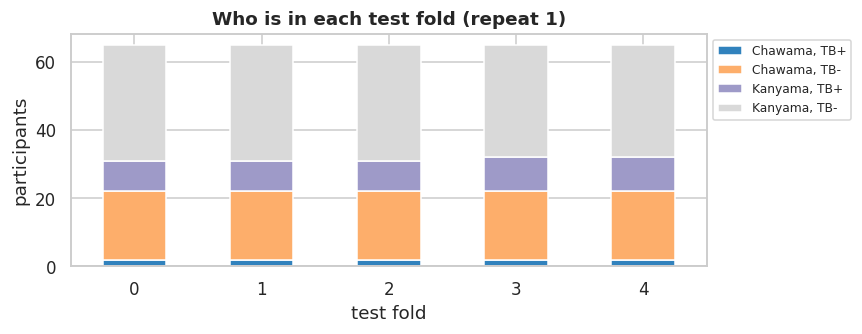</p>
<p align="center">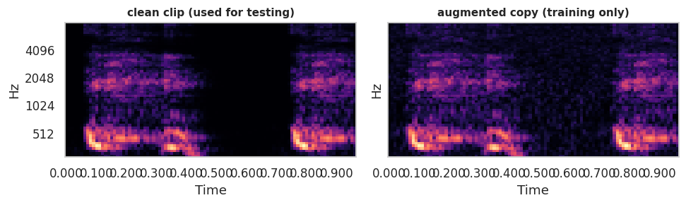</p>

</details>

### 6.3 Model C1: fine-tuned VGGish

<picture>
  <source media="(prefers-color-scheme: dark)" srcset="figures/architecture-dark.svg">
  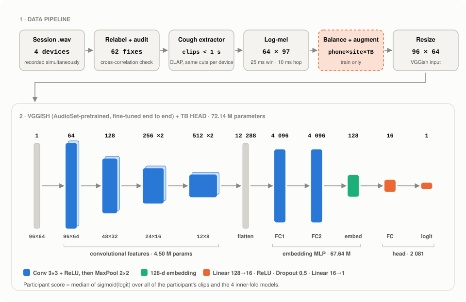
</picture>

**VGGish** [6] is a VGG-style CNN trained by Google on AudioSet to produce a 128-d audio
embedding. We load the pretrained weights and **fine-tune the whole network**, with a small head
that outputs one TB logit.

| Layer | Output shape (C × T × F) | Parameters |
|---|---|---:|
| Input (log-mel, resized) | 1 × 96 × 64 | — |
| Conv1 3×3, 64 → pool | 64 × 48 × 32 | 640 |
| Conv2 3×3, 128 → pool | 128 × 24 × 16 | 73,856 |
| Conv3 3×3, 256 | 256 × 24 × 16 | 295,168 |
| Conv4 3×3, 256 → pool | 256 × 12 × 8 | 590,080 |
| Conv5 3×3, 512 | 512 × 12 × 8 | 1,180,160 |
| Conv6 3×3, 512 → pool | 512 × 6 × 4 | 2,359,808 |
| Flatten | 12,288 | — |
| FC1 + ReLU | 4,096 | 50,335,744 |
| FC2 + ReLU | 4,096 | 16,781,312 |
| FC3 + ReLU (embedding) | 128 | 524,416 |
| Head: Linear + ReLU + Dropout 0.5 | 16 | 2,064 |
| Head: Linear (TB logit) | 1 | 17 |
| **Total** | | **72,143,265** |

| Training setting | Value |
|---|---|
| Loss | `BCEWithLogitsLoss` with `pos_weight = #neg / #pos` |
| Optimiser | Adam; lr 1e-4 for VGGish, 1e-5 for the head |
| Scheduler | `ReduceLROnPlateau` on validation AUROC, factor 0.5, patience 2 |
| Batch size / epochs | 32 / up to 40, early stopping after 5 epochs without improvement |
| Regularisation | Mixup (α = 0.1), dropout 0.5, balanced and augmented training pool |
| Ensemble | 4 inner-fold models per outer fold → 40 models (2 repeats × 5 folds × 4) |
| Scoring | Participant score = median over all their clips and the 4 inner models |
| Hardware | Kaggle GPU (T4), about 5–8 min per outer fold |

**Three defects fixed in the published training code:** (1) pretrained tensors were copied by
*shape*, leaving four VGGish bias vectors random and giving four others another layer's bias;
we load by name with a strict check. (2) The "best" epoch was never restored, because the saved
`state_dict()` pointed at the live weights; we save a deep copy. (3) Test clips were augmented
and duplicated; we test on clean clips only.

### 6.4 Results: cough alone ties with the questionnaire

<picture>
  <source media="(prefers-color-scheme: dark)" srcset="figures/baseline-auroc-dark.svg">
  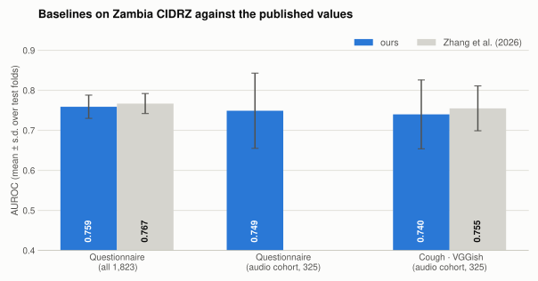
</picture>

| Model | Participants (TB) | AUROC (ours) | Zhang et al. [4] | Spec. @ 90 % sens. |
|---|---|---:|---:|---:|
| B · questions, all participants | 1,823 (205) | 0.759 ± 0.029 | 0.767 ± 0.025 | — |
| B · questions, audio cohort | 325 (57) | **0.749 ± 0.094** | — | 0.358 |
| C1 · cough, fine-tuned VGGish | 325 (57) | **0.740 ± 0.086** | 0.755 ± 0.056 | 0.354 |

| Repeat | AUROC cough | AUROC questions | Δ (cough − questions) | DeLong 95 % CI | p |
|---|---:|---:|---:|---|---:|
| 1 | 0.751 | 0.731 | +0.020 | [−0.069, 0.109] | 0.657 |
| 2 | 0.713 | 0.717 | −0.004 | [−0.094, 0.086] | 0.929 |

Both baselines land within one standard deviation of the published values, and the two models
are statistically indistinguishable on the same people. At 90 % sensitivity both clear only
**35–36 %** of non-TB patients, far short of the WHO's 70 %. Our two full runs differed mainly in
fold assignment, yet the cough model moved from 0.761 to 0.740: with 57 TB cases, differences
below about 0.05 AUROC cannot be detected.

<p align="center">
  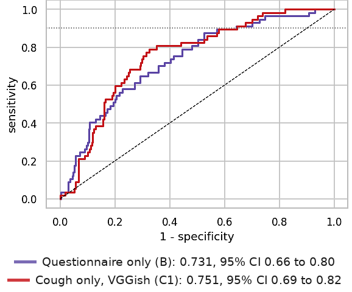
</p>
<p align="center">
  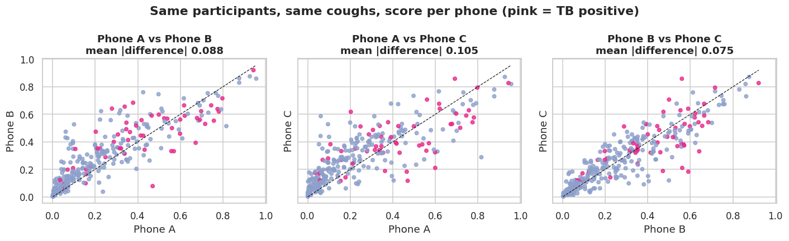
</p>

The same participants receive different scores on each phone, by **0.075–0.105 on average**,
even though every model was trained on all three phones.

### 6.5 What the cough features encode (notebook 02)

A linear classifier, always tested on unseen participants, tries to recover the phone or the
TB status from two kinds of features:

<picture>
  <source media="(prefers-color-scheme: dark)" srcset="figures/probe-dark.svg">
  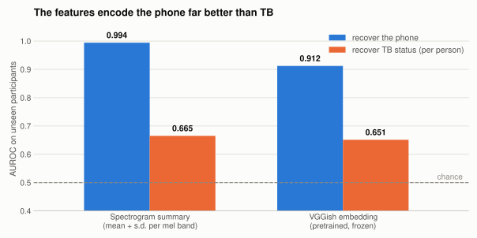
</picture>

| Features | Phone accuracy (chance 0.33) | Phone AUROC | TB AUROC per clip | TB AUROC per person |
|---|---:|---:|---:|---:|
| Spectrogram summary | 0.955 | **0.994** | 0.642 | 0.665 |
| VGGish embedding (pretrained) | 0.772 | **0.912** | 0.601 | 0.651 |

<table>
  <tr>
    <td width="50%">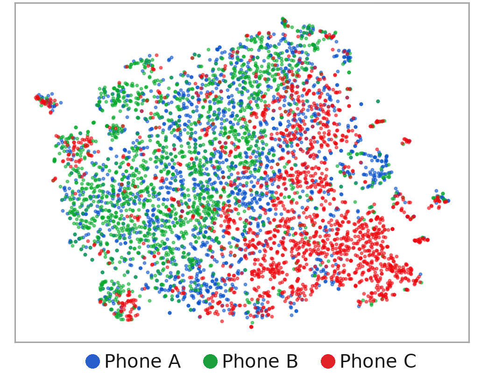</td>
    <td width="50%">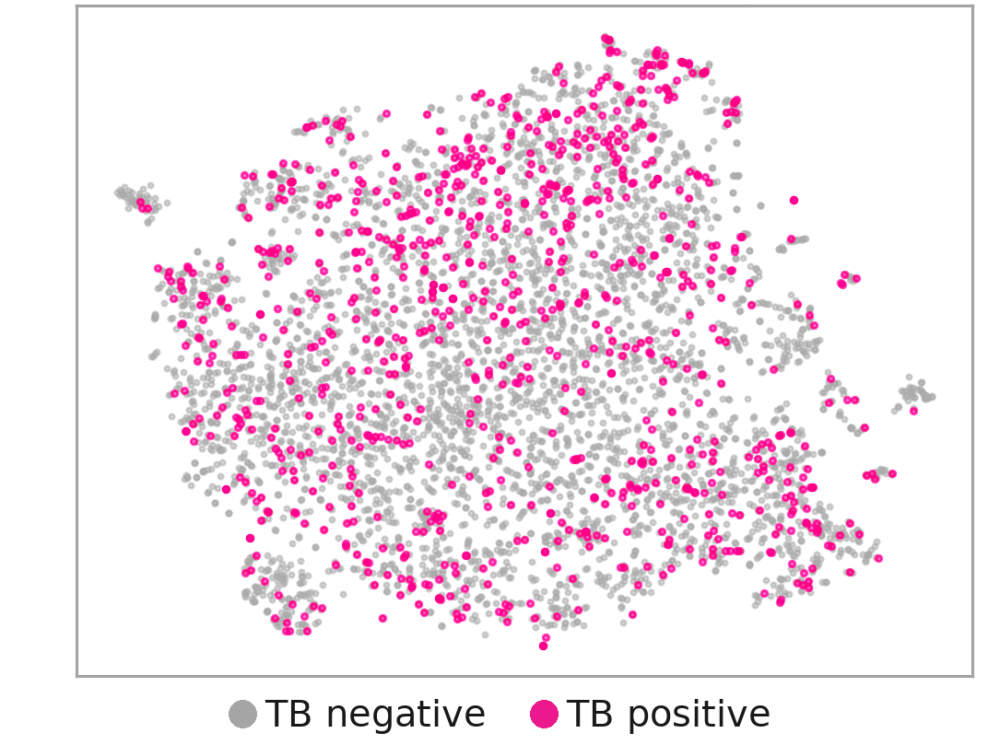</td>
  </tr>
  <tr><td align="center"><b>(a)</b> Coloured by phone</td><td align="center"><b>(b)</b> Coloured by TB status</td></tr>
</table>

- **Same cough, different phone.** For spectrogram statistics, moving one cough to another phone
  changes it as much as swapping in a different person (median cosine distance 0.645 vs 0.626).
- **Site check.** Kanyama's TB rate is more than twice Chawama's, and the features partly reveal
  the clinic (AUROC 0.73). Within Kanyama alone, where that shortcut gives no advantage, TB AUROC
  stays at **0.65–0.69**: the TB signal is real, although weak.
- **Unseen phone.** Removing a phone from training lowers TB AUROC on it, most for Phone C
  (−0.053 with spectrogram summaries, −0.029 with VGGish).

<details>
<summary><b>Zambia embedding-analysis figures and tables</b></summary>

<p align="center">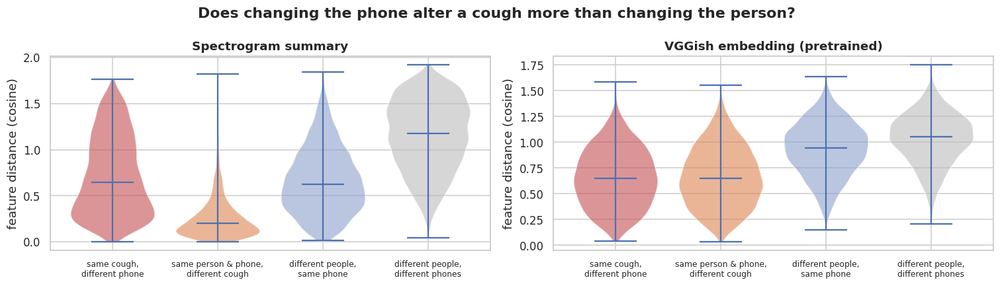</p>

| Pair type (median cosine distance) | Spectrogram summary | VGGish |
|---|---:|---:|
| Same cough, different phone | 0.645 | 0.647 |
| Same person and phone, different cough | 0.198 | 0.647 |
| Different people, same phone | 0.626 | 0.945 |
| Different people, different phones | 1.175 | 1.051 |

<p align="center">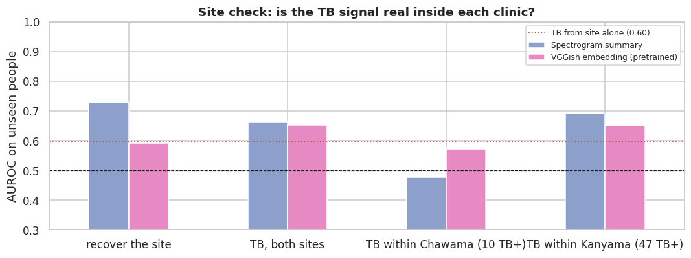</p>

| Features | Held-out phone | TB AUROC, seen | TB AUROC, unseen | Change | Score shift |
|---|---|---:|---:|---:|---:|
| Spectrogram summary | A | 0.697 | 0.671 | −0.026 | 0.064 |
| Spectrogram summary | B | 0.693 | 0.696 | +0.003 | 0.044 |
| Spectrogram summary | C | 0.673 | 0.620 | −0.053 | 0.126 |
| VGGish | A | 0.667 | 0.642 | −0.025 | 0.043 |
| VGGish | B | 0.655 | 0.651 | −0.004 | 0.037 |
| VGGish | C | 0.604 | 0.575 | −0.029 | 0.099 |

</details>

---

## 7. Part II · Kenya TBscreen: a second country

TBscreen [5] recorded coughs in a single clinic room in Nairobi with three devices at once: a
**Pixel phone**, a **boundary (codec) microphone** and a **Yeti studio microphone**. It is a
**case-control** study (TB against other respiratory illness), so its TB rate (69 %) and absolute
AUROCs are not comparable with a triage population; the gain Δ and the transfer results are.

### 7.1 Data and preparation

- **148 labelled participants** (102 TB, 46 non-TB). All nine questions pass the missingness
  check (gaps between TB groups ≤ 8 points).
- **34,153 cough spectrograms** (32,943 natural "passive" coughs, 1,210 forced coughs). TBscreen
  ships precomputed VGGish input spectrograms, so we download those (~0.5 GB) instead of 795 GB of
  audio. We **verified them against the raw audio** with our own port of Google's VGGish front end:
  median correlation **0.9999** over 37 coughs.
- Of the passive coughs, 3,235 exist on all three devices and 5,641 on two, which enables a
  same-cough, different-device comparison as in Zambia.

<p align="center">
  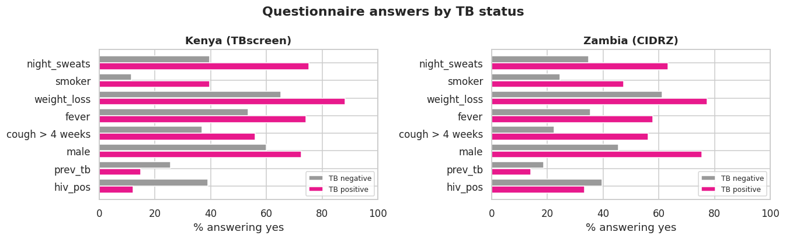
</p>

In Kenya, HIV and previous TB are **far more common among people without TB**, the reverse of
what a triage rule assumes; the controls have other respiratory illnesses.

<details>
<summary><b>More Kenya EDA</b> (coughs per participant, Xpert grades, device pairing)</summary>

<p align="center">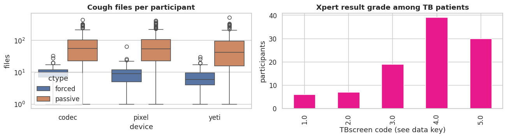</p>
<p align="center">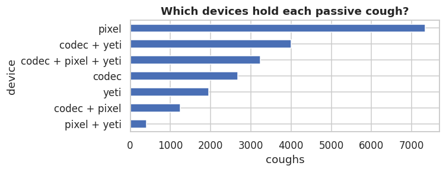</p>

</details>

### 7.2 Baselines and reproduction

All 148 participants, five stratified folds (the published TBscreen T1 fold files were not
attached in this run, so the notebook generated its own participant-level folds):

| Features | B · questions | Cough only | A · questions + cough | Δ = A − B (95 % CI) | p |
|---|---:|---:|---:|---|---:|
| Spectrogram summary | 0.714 | 0.638 | 0.686 | −0.029 (−0.05 to −0.01) | 0.01 |
| VGGish (pretrained) | 0.714 | **0.711** | 0.709 | −0.006 (−0.04 to +0.03) | 0.76 |

| Fine-tuned VGGish | Per cough | Per participant |
|---|---:|---:|
| TBscreen, published [5] | 0.661 ± 0.063 | 0.744 ± 0.138 |
| **Ours** (5 folds) | **0.658 ± 0.107** | **0.702 ± 0.152** |

Our fine-tuned VGGish lands on the published per-cough result. In Kenya the pretrained VGGish
cough model matches the questionnaire (0.711 vs 0.714), yet **combining them adds nothing**, and
with spectrogram summaries the combination is significantly *worse* than the questions alone.

<p align="center">
  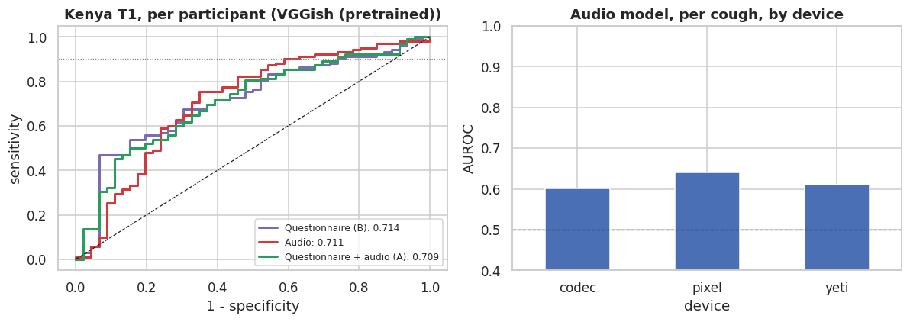
</p>

### 7.3 Device analysis: Kenya is the exception

| Features | Device accuracy (chance 0.33) | Device AUROC | TB AUROC per cough | TB AUROC per person |
|---|---:|---:|---:|---:|
| Spectrogram summary | 0.542 | 0.728 | 0.591 | 0.630 |
| VGGish (pretrained) | 0.480 | **0.666** | 0.613 | **0.712** |

Recorded in one controlled room, Kenya is the one setting where the device is *harder* to
recover than TB. The same cough on two devices stays close (median cosine distance 0.073 for
spectrogram summaries vs 1.0 for two different people), the opposite of Zambia's phones.

<p align="center">
  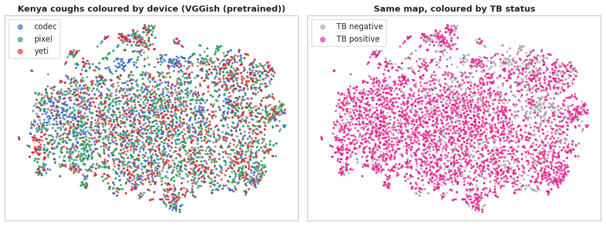
</p>

<details>
<summary><b>Same-cough distances, unseen device, natural vs forced coughs</b></summary>

<p align="center">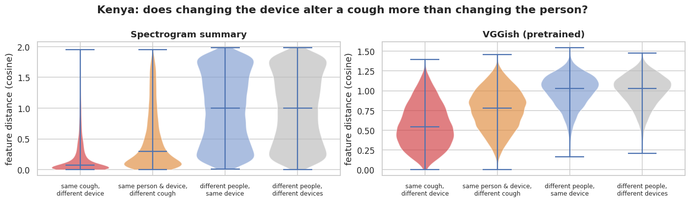</p>

| Features | Held-out device | TB AUROC, seen | TB AUROC, unseen | Change | Score shift |
|---|---|---:|---:|---:|---:|
| Spectrogram summary | codec | 0.598 | 0.618 | +0.020 | 0.054 |
| Spectrogram summary | pixel | 0.620 | 0.545 | −0.075 | 0.059 |
| Spectrogram summary | yeti | 0.688 | 0.636 | −0.052 | 0.038 |
| VGGish | codec | 0.626 | 0.624 | −0.002 | 0.032 |
| VGGish | pixel | 0.707 | 0.637 | −0.070 | 0.050 |
| VGGish | yeti | 0.727 | 0.725 | −0.002 | 0.035 |

<p align="center">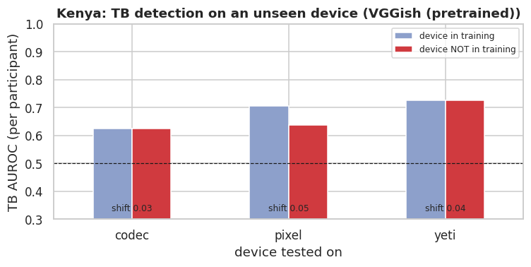</p>

**Natural vs forced coughs.** Only 48 participants gave both types, and only 7 of them are
non-TB; every cell of the transfer matrix is below 0.5, so this comparison is **inconclusive**
and has been dropped from the plan.

<p align="center">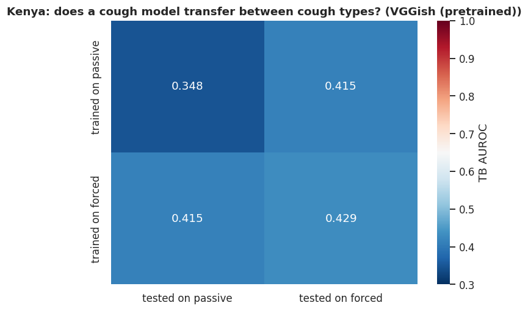</p>

</details>

### 7.4 Zambia ↔ Kenya: does a model travel between countries?

The Zambia clips are passed through the **identical** front end (centred in one second of zeros,
as TBscreen padded its clips) and the pretrained VGGish linear probe, so these Zambia numbers
differ from the fine-tuned model in Part I.

| Setting | Test people (TB) | B · questions | Cough only | A · both | Δ = A − B (95 % CI) |
|---|---|---:|---:|---:|---|
| Zambia, within (5-fold) | 325 (57) | 0.736 | 0.675 | 0.755 | +0.019 (−0.01 to +0.04) |
| Kenya, within (5-fold) | 148 (102) | 0.714 | 0.711 | 0.709 | −0.006 (−0.04 to +0.03) |
| Trained in Zambia → tested in Kenya | 148 (102) | 0.660 | **0.551** | 0.644 | −0.016 (−0.05 to +0.01) |
| Trained in Kenya → tested in Zambia | 325 (57) | 0.683 | **0.585** | 0.679 | −0.003 (−0.02 to +0.02) |

Moving between the countries, the questions lose about 0.05 while the cough loses **0.09 to
0.16** and falls close to chance. A linear probe tells a Zambian cough from a Kenyan one at
**AUROC 0.986**. The two datasets differ in country, devices, protocol, clip preparation *and*
study design, so this shows that transfer fails, not which difference causes it; CODA isolates
the country.

<p align="center">
  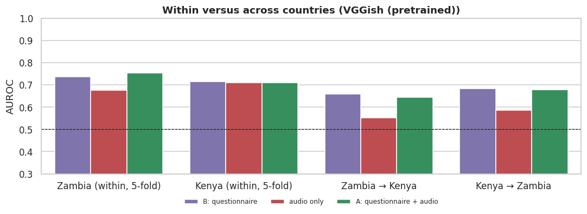
</p>
<p align="center">
  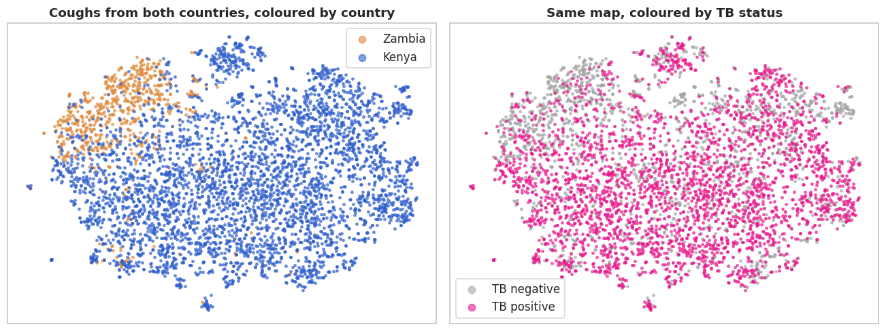
</p>

---

## 8. Part III · CODA: leave-one-country-out

CODA is the heart of the study. Every country used **the same app and the same 0.5 s clip
format**, so differences between countries cannot be blamed on how the data were prepared.

### 8.1 Participants and held-out groups

1,105 participants (297 TB) in the clinical tables; **1,082 with coughs (291 TB)** and
**9,772 solicited coughs**, all recorded at 44.1 kHz and resampled to 16 kHz. CODA's own
`tb_status` agrees with the microbiological reference standard for 100 % of participants.

| Country | Participants | TB | TB rate | Coughs | Median coughs / person |
|---|---:|---:|---:|---:|---:|
| Uganda (UG) | 242 | 81 | 33.5 % | 2,166 | 7 |
| Philippines (PH) | 198 | 19 | 9.6 % | 1,356 | 6 |
| Vietnam (VN) | 163 | 66 | 40.5 % | 1,791 | 10 |
| Madagascar (MG) | 159 | 76 | 47.8 % | 1,293 | 6 |
| South Africa (SA) | 137 | 28 | 20.4 % | 1,119 | 7 |
| India (IN) | 119 | 13 | 10.9 % | 1,043 | 7 |
| Tanzania (TZ) | 87 | 14 | 16.1 % | 1,004 | 10 |

A held-out group needs at least 15 TB cases for a stable AUROC, so **India and Tanzania are
merged**, giving six held-out groups (IN + TZ, MG, PH, SA, UG, VN).

<p align="center">
  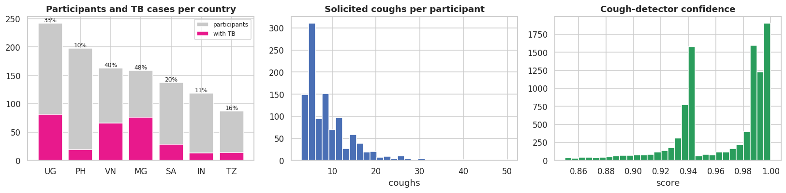
</p>
<p align="center">
  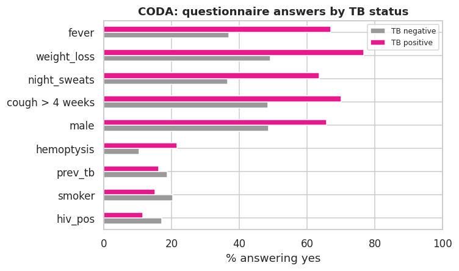
</p>

### 8.2 Random split: the in-distribution reference

Five participant folds that mix all countries, which is how most published cough results are
measured.

| Representation | B · questions | Cough only | A · both | Δ = A − B |
|---|---:|---:|---:|---|
| MFCC summary | 0.731 | 0.676 | 0.744 | +0.013 |
| Spectrogram summary | 0.731 | 0.678 | 0.745 | +0.014 |
| VGGish (pretrained) | 0.731 | **0.684** | 0.745 | **+0.014 (+0.00 to +0.02), p = 0.01** |
| Extended questions (+ VGGish) | **0.810** | — | 0.812 | +0.002 |

The cough alone (0.684) sits just below the challenge teams' 0.69–0.74 with a much simpler
model. The nine shared questions reach 0.731, and CODA's four extra variables lift the questions
alone to **0.810**, already inside the challenge's range for cough *plus* clinical data.

### 8.3 Leave-one-country-out: the main experiment

For each held-out group, all three models are trained on the **other** countries only. Nothing
about the held-out country (scaling, imputation, threshold) is used in training.

| Held-out | People | TB | B | Cough | A | Δ = A − B (95 % CI) | A: sens / spec, frozen threshold |
|---|---:|---:|---:|---:|---:|---|---|
| IN + TZ | 205 | 27 | 0.691 | 0.528 | 0.686 | −0.005 (−0.04 to +0.03) | 0.93 / 0.22 |
| MG | 157 | 75 | 0.762 | **0.434** | 0.685 | **−0.076 (−0.12 to −0.04)** | 1.00 / **0.00** |
| PH | 191 | 19 | 0.642 | 0.458 | 0.642 | +0.000 (−0.04 to +0.04) | 0.58 / 0.66 |
| SA | 135 | 28 | 0.591 | 0.543 | 0.596 | +0.005 (−0.03 to +0.04) | 0.57 / 0.43 |
| UG | 233 | 78 | 0.677 | 0.505 | 0.674 | −0.003 (−0.03 to +0.02) | 0.97 / 0.07 |
| VN | 161 | 64 | 0.780 | 0.569 | 0.776 | −0.004 (−0.02 to +0.01) | 0.78 / 0.58 |
| **All (pooled)** | 1,082 | 291 | 0.707 | 0.638 | 0.714 | **+0.008 (−0.00 to +0.02), p = 0.12** | 0.87 / 0.34 |
| **Mean over groups** | | | 0.690 | **0.506** | 0.676 | | |
| **Worst group** | | | 0.591 | 0.434 | 0.596 | | |

*Pretrained VGGish. The MFCC and spectrogram summaries behave the same way: pooled Δ +0.002 and
−0.000, mean within-country cough AUROC 0.546 and 0.535.*

<p align="center">
  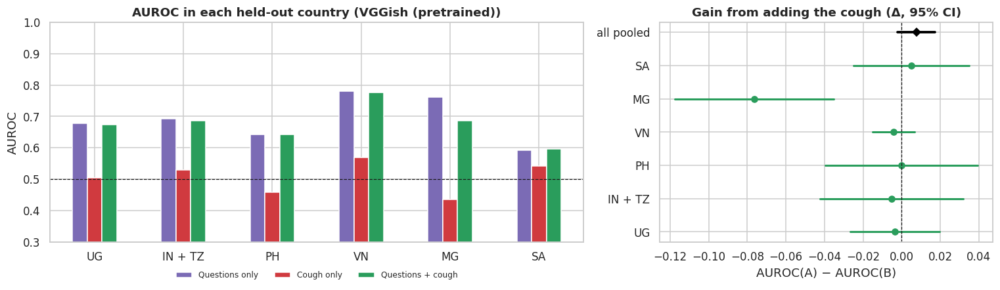
</p>

- **The answer to our question, for these representations, is no.** In five of six held-out
  groups the gain lies within ±0.005; in Madagascar adding the cough makes things worse.
- **Inside a new country the cough alone is near chance** (mean 0.506), and below 0.5 in
  Madagascar and the Philippines. The questions lose far less.
- **Extended questions** under leave-one-country-out: B 0.794, A 0.793, Δ −0.001 (p = 0.76).
- **Thresholds do not travel.** A threshold set on the other countries for 90 % sensitivity
  catches every TB case but clears **no one** in Madagascar, and catches only 57 % of TB cases in
  South Africa. Pooled, the combined model clears only 34 % of non-TB patients (WHO target: 70 %).

### 8.4 How optimistic is the random split?

| Representation | Model | Random split | New country (pooled) | Drop |
|---|---|---:|---:|---:|
| MFCC summary | Questions | 0.731 | 0.707 | 0.025 |
| MFCC summary | Cough | 0.676 | 0.598 | **0.078** |
| Spectrogram summary | Cough | 0.678 | 0.603 | 0.076 |
| VGGish (pretrained) | Questions | 0.731 | 0.707 | 0.025 |
| VGGish (pretrained) | Cough | 0.684 | 0.638 | 0.045 |
| VGGish (pretrained) | Questions + cough | 0.745 | 0.714 | 0.031 |

Against the **within-country** average (0.506–0.546), the cough loses **0.13 to 0.18** from its
random-split score, while the questions lose 0.04 (0.731 → 0.690).

<p align="center">
  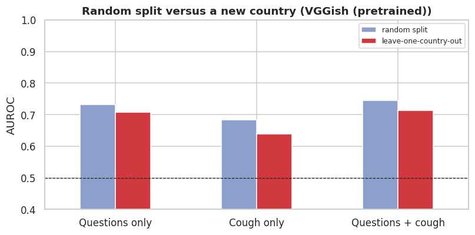
</p>

### 8.5 A cough reveals its country

| Representation | Country accuracy (chance 0.14) | Country AUROC | TB AUROC per person |
|---|---:|---:|---:|
| MFCC summary | 0.732 | **0.943** | 0.666 |
| Spectrogram summary | 0.717 | **0.938** | 0.669 |
| VGGish (pretrained) | 0.613 | **0.900** | 0.675 |

Although every country used the same app and identical clips, a linear probe names the country
from a single cough far better than it detects TB, so the signature comes from people, rooms or
phones, not from data preparation. **The more a representation reveals the country, the more it
loses in a new country** (MFCC: country 0.94, drop 0.078; VGGish: 0.90, drop 0.045).

<p align="center">
  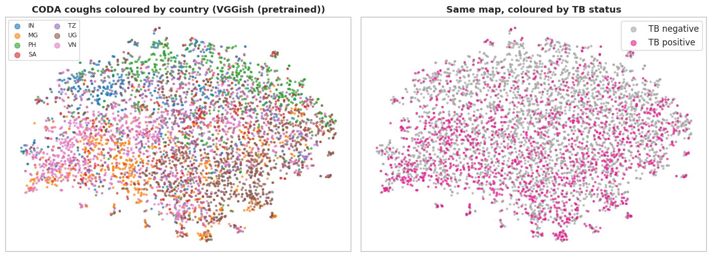
</p>

**A country shortcut is possible.** TB rates range from 10 % in the Philippines to 48 % in
Madagascar. In the team's follow-up analysis, a score that knows only each country's TB rate
reaches AUROC **0.700**, higher than the random-split cough model (0.684), and the pooled
leave-one-country-out cough AUROC (0.638) sits well above the per-country average (0.506): the
cough scores differ *between* countries more than they rank people *within* one. This is a
**hypothesis, not yet a result**; Experiment 1 tests it directly.

---

## 9. Synthesis across the three datasets

<picture>
  <source media="(prefers-color-scheme: dark)" srcset="figures/context-vs-tb-dark.svg">
  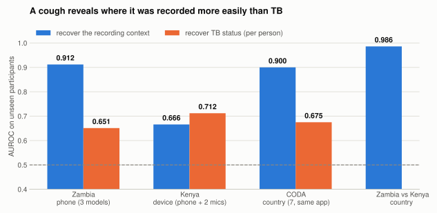
</picture>

| Question | Zambia | Kenya | CODA |
|---|---|---|---|
| Does the pipeline reproduce published results? | ✅ 0.740 vs 0.755 | ✅ 0.658 vs 0.661 per cough | ✅ 0.684 vs 0.69–0.74 |
| Does the cough add to the questions within the population? | +0.019 (n.s.) | −0.006 (n.s.) | +0.014 (p = 0.01) |
| … in a new country? | −0.003 (model trained in Kenya) | −0.016 (model trained in Zambia) | +0.008 (n.s.); MG −0.076 |
| Is the recording context easier to read than TB? | Yes (phone 0.91–0.99) | **No** (device 0.67–0.73) | Yes (country 0.90–0.94) |

Cough audio holds a **real but weak** TB signal (it survives within one Zambian clinic) next to a
**much stronger** signal from the recording context. Within one dataset a model tolerates that
imbalance. Across countries, which differ in phones, clinics and recording environments, the
strong signal shifts while the weak one must carry the prediction. This is a plausible
mechanism behind drops such as the Peruvian result [3].

## 10. Discussion, limitations and risks

| Area | Issue | Mitigation |
|---|---|---|
| Sample size | 57 TB cases in Zambia; the Philippines has 19 | Lead with the within-country average and the pooled gain; bootstrap per country; single countries are exploratory |
| Attribution | Country hold-out mixes device, clinic, recruitment and severity | Zambia and Kenya isolate the device; Experiments 1–3 probe the country shortcut |
| Study design | Kenya is case-control, so absolute AUROCs are not comparable | Compare Δ and transfer, not AUROC |
| Clip preparation | Zambia clips were padded with silence, CODA clips are 0.5 s | Experiment 6 cuts all three datasets to identical 0.5 s clips |
| Questions | Some answers mean different things in different places (HIV, previous TB in Kenya; smoking definition in CODA) | Experiment 5 measures local recalibration for the questions too |
| Representations | General audio features only so far | HeAR and OPERA in Experiment 4 |
| Data governance | Private storage and Kaggle notebooks to be added to the data use statement | Amendment this week; exports stay aggregate-only |

## 11. Roadmap: the final four weeks

Four workstreams run in parallel from 10 November, with three gates that keep Week 4
(ending 7 December) free for writing. All experiments except Experiment 6 run on the CODA data
and plug into notebook 04.

| # | Experiment | Answers | Owner (proposed) | Priority |
|---|---|---|---|---|
| 1 | **Country shortcut test:** score the cough inside each country and against a country-only score | How much accuracy is a shortcut? | Martin | Core, first |
| 2 | **Bacterial-load check:** does the cough score rise with Xpert grade within a country? | Shortcut vs real signal | Martin | Core |
| 3 | **Removing recording context:** loudness levelling and per-country standardisation | Can simple fixes help? | Yusuf | Core |
| 4 | **Health-specific encoders:** HeAR and OPERA under leave-one-country-out | Does a better encoder change the answer? | Odunayo | Core |
| 5 | **Local data needed:** threshold reset and retraining with 10–100 local patients | What does a new country need? | Yusuf | Core |
| 6 | **External test:** CODA-trained models on Zambia and Kenya with identical 0.5 s clips; nine-country probe | Does it hold on other studies? | Michael | Core |
| 7 | **Who benefits:** the gain by HIV status and sex | Targeted use? | Martin | Add-on |
| 8 | **Adapting the encoder:** fine-tune the best encoder, compare with frozen | Frozen vs adapted | Odunayo | Stretch |

| Gate | Date | Must be true to pass | Decides |
|---|---|---|---|
| 1 · Shortcut verdict | Mon 16 Nov | Experiments 1–2 done; first Experiment 3 table; Zambia clips ready | The paper's headline |
| 2 · Encoder freeze | Mon 23 Nov | HeAR and OPERA embeddings cached; main results table filled; Experiment 7 done | Representations in the paper; go/no-go on Experiment 8 |
| 3 · Results freeze | Mon 30 Nov | Every table and figure in the shared folder | No new experiments after this |

**Rules every experiment follows**

- **Same people, same groups.** Use `coda_folds.csv` from notebook 04 (five random folds
  `rfold`, six held-out groups `group`). Never re-split. The file lists participant IDs, so it
  stays in the private Kaggle session and is **never committed**.
- **Same headline numbers.** Under leave-one-country-out, report the mean of within-country
  AUROCs, the pooled gain Δ with its DeLong interval, and the worst country.
- **Same operating point.** Sensitivity and specificity at a threshold fixed on the training
  countries for 90 % sensitivity.
- **No peeking.** Never use the held-out country's labels except for scoring (Experiment 5 is the
  one documented exception). Settings are chosen on the random split or inner folds.
- **Same file format.** One CSV per experiment in `results/e<N>_<name>/`, one row per number, with
  the columns below, plus PNG figures and a short `notes.md`.

| Column | Example | Meaning |
|---|---|---|
| `experiment` | `e1` | Experiment number |
| `variant` | `rebalanced` | Version within the experiment |
| `representation` | `vggish` | `mfcc`, `spectrogram`, `vggish`, `hear`, `opera` |
| `protocol` | `loco` | `random`, `loco` or `external` |
| `test_group` | `MG` | Held-out group, country, subgroup or `pooled` |
| `model` | `A` | `B`, `audio`, `A`, or a named reference model |
| `n_people`, `n_tb` | `157`, `75` | Size of the test set |
| `auroc`, `auroc_lo`, `auroc_hi` | `0.685`, `0.60`, `0.77` | AUROC with 95 % bootstrap interval |
| `delta`, `delta_lo`, `delta_hi`, `p` | `-0.076`, `-0.12`, `-0.04`, `0.001` | Gain A − B with DeLong interval (B and A rows) |
| `sens_frozen`, `spec_frozen` | `1.00`, `0.00` | At the threshold fixed on training data |
| `seed`, `notebook_version` | `42`, `v7` | To reproduce the run |

**Dropped from earlier plans:** adversarial training against country (replaced by Experiment 3),
pitch and voice-quality features, forced coughs (not in the data use statement; inconclusive in
Kenya), CODA longitudinal coughs, a CODA device-swap analysis (no device labels), and full
fine-tuning of every encoder (reduced to Experiment 8).

**Path to publication.** The course report becomes the first draft of a paper, working title
*What survives a change of country? Cough audio for TB triage under country shift*, with a
preprint after the course and Interspeech 2027 as the main target venue. Before submitting
anywhere, check CODA's conditions for publications.

## 12. Repository structure

```
IDL_F26_CoughTB/
├── README.md                               # this document
├── docs/
│   └── progress_report.pdf                 # midterm progress report (Zambia stage)
├── notebooks/
│   ├── 01_zambia_baseline.ipynb            # Zambia: audit, segmentation, cohort, Baselines B and C1
│   ├── 02_embedding_analysis.ipynb         # Zambia: phone vs TB probes, same-cough distances, unseen phone
│   ├── 03_kenya_tbscreen_baselines.ipynb   # Kenya: baselines, reproduction, device analysis, Zambia ↔ Kenya
│   └── 04_coda_leave_one_country_out.ipynb # CODA: random split, leave-one-country-out, country probe
├── figures/
│   ├── *-{light,dark}.svg                  # generated by scripts/make_figures.py
│   ├── *.png                               # figures from the progress report
│   ├── notebook/                           # Zambia figures from notebooks 01 and 02
│   ├── kenya/                              # figures from notebook 03
│   └── coda/                               # figures from notebook 04 (aggregate only)
├── scripts/
│   └── make_figures.py                     # regenerates the SVG figures
└── .gitignore                              # keeps audio, features, bundles, weights and fold files out
```

No dataset files are included. Everything the notebooks need is read from Kaggle or the team's
private storage at run time.

## 13. Reproducing the results

All four notebooks are written for **private Kaggle notebooks** with **Internet on**.

| Notebook | Add data / secrets | Accelerator |
|---|---|---|
| 01 Zambia | Dataset `googlehealthai/google-health-ai` | GPU T4. Run first with `FAST_MODE = True` (≈ 1–2 h), then `False` for the full protocol |
| 02 Embedding analysis | The `zambia_features_mel` bundle exported by notebook 01 | None needed |
| 03 Kenya | Secret `AZURE_STORAGE_CONNECTION_STRING`; the notebook 01 Zambia bundles; optionally the TBscreen code folder for the published T1 folds | GPU T4 |
| 04 CODA | Secret `AZURE_STORAGE_CONNECTION_STRING` (personal read-only token for the `coda` container) | GPU T4 (only Step 6) |

To run notebook 04 you must be certified for CODA on Synapse and named in the data use
statement. Make a **private** copy of the notebook, add the secret under *Add-ons → Secrets*,
and run it once to create the cached waveforms, embeddings and `coda_folds.csv` used by every
experiment. Its export bundle `coda_results.zip` holds aggregate tables and figures only.

To rebuild the generated SVG figures:

```bash
pip install matplotlib
```

```bash
python scripts/make_figures.py
```

## 14. References

1. World Health Organization. *High-Priority Target Product Profiles for New Tuberculosis Diagnostics.* WHO, 2014.
2. D. Jaganath et al. "Accelerating cough-based algorithms for pulmonary tuberculosis screening: Results from the CODA TB DREAM Challenge." *Open Forum Infectious Diseases* 12(10), 2025.
3. A. J. Zimmer et al. "External validation of cough-based algorithms for pulmonary tuberculosis screening from the CODA TB DREAM Challenge using cough data from Peru." *Scientific Reports*, 2026.
4. W. Zhang, T. Teijeiro, J. Thevenot, D. Atienza. "Why ML-based cough models do not generalize: A systematic cross-dataset evaluation for tuberculosis screening." arXiv:2608.25846, 2026. Code: [esl-epfl/tb-cough-generalization](https://github.com/esl-epfl/tb-cough-generalization).
5. M. Sharma et al. "TBscreen: A passive cough classifier for tuberculosis screening with a controlled dataset." *Science Advances* 10(1), 2024.
6. S. Hershey et al. "CNN architectures for large-scale audio classification." *ICASSP*, 2017.
7. S. Baur et al. "HeAR: Health acoustic representations." arXiv:2403.02522, 2024.
8. Y. Zhang et al. "Towards open respiratory acoustic foundation models: Pretraining and benchmarking." *NeurIPS Datasets and Benchmarks*, 2024.
9. E. J. Hu et al. "LoRA: Low-rank adaptation of large language models." *ICLR*, 2022.
10. H. Coppock et al. "Audio-based AI classifiers show no evidence of improved COVID-19 screening over simple symptoms checkers." *Nature Machine Intelligence* 6(2), 2024.
11. G. P. Kafentzis, E. Selisios. "Tuberculosis screening from cough audio: Baseline models, clinical variables, and uncertainty quantification." *Sensors* 26(4), 2026.
12. R. A. Buyung, W. Nugroho. "Multimodal deep learning for tuberculosis detection using cough audio and clinical data with health acoustic representations (HeAR)." *IJACSA* 16(10), 2025.
13. S. Huddart et al. "Solicited cough sound analysis for tuberculosis triage testing: The CODA TB DREAM Challenge dataset." *Scientific Data* 11, 2024.
14. E. R. DeLong, D. M. DeLong, D. L. Clarke-Pearson. "Comparing the areas under two or more correlated receiver operating characteristic curves: A nonparametric approach." *Biometrics* 44(3), 1988.
15. B. Elizalde, S. Deshmukh, H. Wang. "Natural language supervision for general-purpose audio representations." *ICASSP*, 2024.

## 15. Acknowledgements

- **CODA TB DREAM:** data from the CODA TB DREAM Challenge consortium, accessed through Synapse
  (`syn39711065`) under a data use agreement. We thank the participants and the study teams in
  all seven countries.
- **Zambia CIDRZ:** data collected by CIDRZ with Google Health AI, distributed on Kaggle
  (`googlehealthai/google-health-ai`).
- **Kenya TBscreen:** Sharma et al. [5].
- The cough extractor, relabelling log and Zambia training recipe come from **Zhang et al.
  (2026)**, [esl-epfl/tb-cough-generalization](https://github.com/esl-epfl/tb-cough-generalization)
  (MIT licence). The VGGish front end is ported from Google's AudioSet `mel_features.py` /
  `vggish_input.py` (Apache 2.0); pretrained weights from
  [harritaylor/torchvggish](https://github.com/harritaylor/torchvggish).
- Course staff of 11-785 Introduction to Deep Learning at Carnegie Mellon University.

**Team and workstreams:** Martin Koome (shortcut and statistics), Odunayo Akinlade (encoders),
Yusuf Olaniyi (fixes and local data), Michael Quaicoe (external data).
